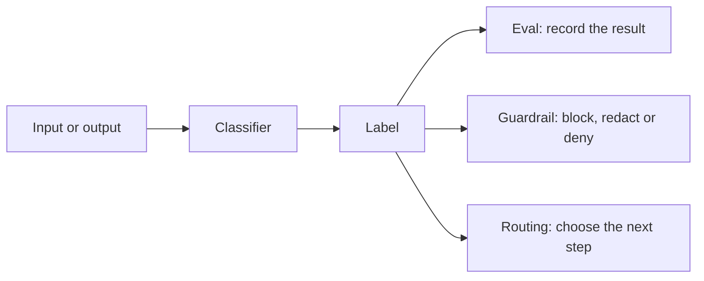

# Module 2. Graders

!!! abstract "In this module"
    **You will learn:** the three kinds of grader (code, model and human), why "code versus model" is the split that matters, and how to tell evals apart from guardrails, routing, tests and benchmarks by separating the mechanism from the intent.

    **Reading time:** about 5 minutes.

## Three kinds of graders { #graders }

Every eval needs something that decides pass or fail. That something is the **grader**. The distinction that matters is **who wrote the decision logic**, not whether the grader is "deterministic":

-   **Code (explicit logic)**

    ---

    You wrote the logic and every condition is visible. Regex, assertions, JSON schema validation, SQL result comparison, HTTP status checks.

    If it passes today you know exactly why, and it will pass tomorrow for the same input (provided it does not depend on an external system that changes).

-   **Model (learned logic)**

    ---

    The decision logic was learned from data. LLMs, [decision models](glossary.md#decision-model), ML classifiers.

    You cannot read the rules; they are in the model's weights. You must validate the model's behaviour against labelled examples.

-   **Human (expert judgement)**

    ---

    A domain expert reads the output and decides. Slow and expensive, but it is the ground truth everything else is measured against.

    Humans do not grade everything. They **define** what good looks like and **validate** the other two.

A model-based grader is usually called a **judge**. The most common kind is an LLM given a prompt that describes what to check: this is called **LLM-as-judge**.

??? info "What are 'weights'? (only if the term is new to you)"
    A model's behaviour is not written as code. It is produced by *training*: automatically adjusting millions or billions of numbers (the *weights*) until the model's outputs fit a large set of examples. You can run the result, but you cannot read its rules, so the only way to know what a model does is to test its behaviour.

### Deterministic is not the same as correct

Classifiers and decision models that you self-host with pinned weights usually give the same answer every time. Hosted LLMs often do not, even at the lowest randomness setting (called *temperature*), and a hosted decision model can change when its provider updates it. You will learn to measure how often a judge's verdicts flip in [Module 9](09-run-and-monitor.md#step-6).

But a grader that always gives the same answer can still give the same **wrong** answer every time. Because you cannot read a model's rules, every model-based grader needs testing against labelled examples, whether or not it is deterministic. That is why "code versus model" is a more useful split than "deterministic versus non-deterministic" (see [non-deterministic](glossary.md#non-deterministic)).

## Evals, guardrails, routing, tests and benchmarks { #evals-guardrails-routing }

This is where most of the confusion comes from when people talk about evals, tests, guardrails, benchmarks or "an LLM as orchestrator". The cause is mixing up two separate things:

- **The mechanism:** a [classification](glossary.md#classifier). Something reads an input or output and assigns a label, such as pass/fail, yes/no or a category.
- **The intent:** what you do with that label afterwards.

Same mechanism, different intent. A toxicity classifier can grade replies in an eval, recording how often the system is offensive. The very same classifier can sit in front of the model as a guardrail and block a user from sending something they should not. Likewise, when an LLM acts as an orchestrator and picks which tool or agent handles a request, it is classifying the request and using the label to route it.

| Classification question | Used as an **[eval](glossary.md#evaluation)** (record pass/fail, [offline or online](glossary.md#offline-online)) | Used as a **[guardrail](glossary.md#guardrail)** (enforce, online at the input or output boundary) | Used for **orchestration or routing** (decide the next step inside an LLM workflow or agent, online) |
|---|---|---|---|
| Is this text toxic? | Measure the share of toxic replies on a dataset or a sample of live traffic | Block the user's message, or stop a toxic reply before it is shown | Hand the conversation to a human moderator |
| Does this contain personal data? | Count how often replies leak personal data | Redact the personal data before it is shown or logged | Send the request down a stricter path, for example one that never stores it |
| Is this a prompt injection or jailbreak attempt? | Measure how often attacks get through, for example on a [red-teaming](glossary.md#red-teaming) set | Deny the request | Send it to a restricted agent with no tool access, or to a human for review |
| What topic or intent is this? | Check how often the system answers off-topic questions it should decline | Refuse anything outside the allowed topics | "This is a billing question": send it to the billing agent |
| Is the answer supported by the retrieved sources? | Score [faithfulness](glossary.md#faithfulness) across a batch of [RAG](glossary.md#rag) answers | Withhold an unsupported answer and show a fallback message | Retrieve more documents and try again |

The table shows why the question "which one is it?" cannot be answered by looking at the classifier. You have to look at the action. Tests and benchmarks fit the same picture. Both record a result, as an eval does; what differs is what the result is used for:

- **Test.** In an LLM system, a test usually means a code-based check with explicit logic (a [code grader](#graders)) run offline, for example in CI, on the system's outputs. *Mechanism:* usually a code grader you wrote. *Intent:* gate a change; a failing test blocks the merge or release. That makes it an eval whose grader you wrote yourself. Some teams also call model-based evals run in CI "tests", so ask which they mean.
- **Benchmark.** *Mechanism:* the same, any grader. *Intent:* compare models or versions on a fixed, often public, dataset, on equal terms. It tells you how a model does on *that* dataset, not on your own use case.

Stakeholders often use these words interchangeably. When someone says "we need evals" or "we need guardrails", ask *"what classifies, and what happens after it classifies?"* Separating the mechanism from the intent tells you whether they really want an eval (measure), a guardrail (enforce) or routing (decide). This course is about evals.

## Key takeaways

- There are three kinds of grader: **code**, **model** and **human**. Humans define "good" and validate the other two.
- What matters is **who wrote the decision logic**. Any grader whose rules you cannot read must be tested against labelled examples.
- Separate the **mechanism** (a classifier assigns a label) from the **intent** (what happens next). The same classifier can power an eval (record), a guardrail (block, redact or deny) or routing (choose the next step).
- In an LLM system, a **test** usually means a code-based eval run offline in CI to gate a change (some teams also call model-based CI evals "tests"); a **benchmark** is an eval on a fixed, often public, dataset used to compare models or versions.

## Check your understanding

??? question "You pin a classifier's weights and it gives the same verdict every time. Do you still need to test it against labelled examples?"
    Yes. Deterministic means consistent, not correct. A pinned classifier can be consistently wrong, and you cannot read its rules, so you measure its behaviour against expert labels.

??? question "A toxicity classifier blocks offensive replies before they reach the user. Is that an eval?"
    No, that is a guardrail: the action after classification is to block. The same classifier would be an eval if it only recorded a score or a pass/fail verdict on a sample of replies, that is, if the intent were to measure. Same mechanism, different intent.

??? question "A stakeholder asks for 'an eval that checks whether the user is asking about billing, then sends them to the billing agent'. Is that an eval?"
    No. The mechanism is a classifier (topic or intent), but the intent is to decide the next step, so it is routing. It becomes an eval only if you record the labels to measure something, for example how often requests are routed to the wrong agent.

??? question "What is the human grader's main job, if humans do not grade everything?"
    To define what "good" means and to label examples that are used to validate the code and model graders.

**Next:** [Module 3. Define what matters and collect data](03-define-and-collect.md)
