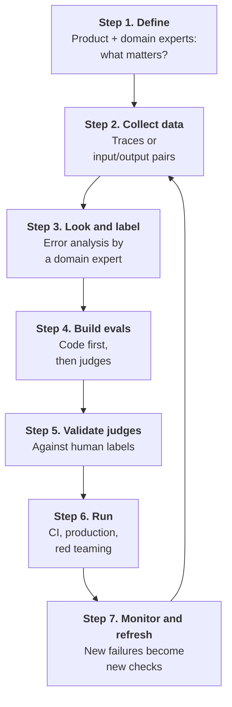

# Module 3. Define what matters and collect data

!!! abstract "In this module"
    **You will learn:** the seven-step eval lifecycle that the rest of the course follows, who decides what "good" means for your system, and what data to capture so you have something to evaluate.

    **Reading time:** about 10 minutes.

## The AI evals lifecycle { #lifecycle }

Good evals are a loop, not a script you write once. This is the lifecycle the course follows. Each step ends with a "Done when", except Step 7, which runs for the life of the system.



| Step | Covered in |
|---|---|
| 1. Define what matters, 2. Collect data | This module |
| 3. Look at the data and label it | [Module 4](04-error-analysis.md) |
| 4. Build evals | [Module 5](05-build-checks.md) |
| 5. Validate judges | [Modules 6 to 8](06-measuring-a-judge.md) |
| 6. Run, 7. Monitor and refresh | [Module 9](09-run-and-monitor.md) |

## Step 1: Define what matters (product and domain experts first) { #step-1 }

Evals start with people, not tools. An engineer can build the harness, but an engineer alone usually cannot say what "good" means for a claims assistant, a support bot or a recommendation agent. That judgement comes from two groups:

- **Product owners** decide what the system is *for* and what failures the business cannot accept ("never promise a refund the policy does not allow", "always escalate self-harm mentions to a human").
- **Subject-matter experts (SMEs)**, also called domain experts, know what a correct, safe, on-brand answer looks like in practice. They read outputs and label them.

Two practices make this work:

1. **Name one lead domain expert** whose judgement is final on pass or fail. A committee produces inconsistent labels and slow decisions. (Hamel Husain calls this person the "[benevolent dictator](glossary.md#benevolent-dictator)".) Adding more labellers and measuring how often they agree is only worth it later, for critical evals; see [the optional note in Module 4](04-error-analysis.md#labelling).
2. **Expect the criteria to change.** People often do not know what they want until they see real outputs. Shankar et al. call this *criteria drift*. It is why you [read data before writing rubrics](04-error-analysis.md), and why labels and judges need re-checking when the definition of "good" moves ([Module 9](09-run-and-monitor.md#step-7)).

**Who does what, and how much time it takes** (rough planning figures for one system, not promises):

| Role | What they do | Rough time |
|---|---|---|
| Product owner | Approves the one-page definition below; reviews the failure list; decides the release gate and acceptable trade-offs (for example the [threshold](08-scores-and-thresholds.md#threshold)) | About 1 hour at the start, then about 30 minutes per fortnight |
| Lead domain expert | Reads traces and writes notes (Step 3); labels examples for each judge (Step 5) | About 3 to 5 hours for the first error analysis (100 traces at 2 to 3 minutes each), then 2 to 3 hours per judge for labelling |
| Engineers | Capture traces, build the harness, write code checks, run the evals, show traces to experts in a readable view | Most of the build time |

If you cannot get meaningful expert time in the first two weeks (as a rough guide, around 8 hours), fix that first.

!!! note "Working on your own or in a small team?"
    You may hold several of these roles at once. That is fine, as long as the pass or fail decisions come from someone who genuinely knows the domain. If that is not you, find that person before you build judges.

**Output of this step: a one-page definition.** For example:

```text
Purpose:              Answer billing and refund questions for retail customers.
Users:                Customers in AU/NZ, mostly mobile, often frustrated.
Unacceptable failures (max 5, each an observable behaviour):
  1. States a refund window that differs from current policy.
  2. Promises a refund or exception it is not authorised to give.
  3. Gives medical, legal or financial advice.
  4. Fails to hand over to a human when asked or when a legal threat is made.
  5. Exposes another customer's data.
Out of scope:         Product recommendations.
Lead expert:          <name>, available <hours per week>.
Signed off by:        <product owner>.
```

**Done when:** the product owner and the lead expert have both read it, and each could name the top three unacceptable failures from memory.

## Step 2: Collect data { #step-2 }

You cannot evaluate what you did not capture. There are two starting points.

**A. You have a deployed system or a prototype that people (or testers) use.** Capture **traces.**

!!! info "Trace, span, session"
    A **trace** is everything that happened to serve one request, as a tree of **spans**: one span per step, such as an LLM call, a retrieval or a tool call, each with timings, status and attributes. A **session** groups the traces of one conversation. For a single-turn system, label at trace level. For multi-turn chat, label the whole session (and use the per-turn trace to find where it went wrong).

### Example: a trace

One trace for the [refund agent](index.md#running-example), simplified. Note how much is invisible if you only see the final answer:

```json
{
  "trace_id": "t-8f21",
  "session_id": "s-3f9a1c",
  "prompt_version": "support-agent@v14",
  "model": "<your model>",
  "input": "Can I get a refund? I bought it 45 days ago.",
  "steps": [
    {"type": "retrieval", "query": "refund policy", "doc_ids": ["policy-2022-refunds", "policy-2024-refunds"]},
    {"type": "tool_call", "name": "get_order", "args": {"order_id": "A1042"}, "result": {"purchased_days_ago": 45, "status": "delivered"}},
    {"type": "llm", "output_summary": "decided refund is allowed"}
  ],
  "output": "Yes, you are within our 60-day refund window. I have started your refund.",
  "latency_ms": 5200,
  "user_feedback": "thumbs_down"
}
```

A reviewer reading this sees what an output-only check would miss: the agent retrieved *two* policy documents (an old 60-day one and the current 30-day one) and used the wrong one.

!!! tip "Why traces matter more for agents"
    For a single LLM call, input and output are often enough. For an agent the final answer can look fine while the *path* was wrong: it called the wrong tool, ignored a tool error, retrieved the wrong document or looped. You only see that in the trace. If the agent takes actions with side effects, the trace is your audit trail as well as your eval data.

**B. You have nothing yet.** Start with **input/output pairs** and build up traces as you run the system. You need realistic *inputs* first: write them with the product owner and an expert, take them from existing support tickets, FAQs or search logs, or generate synthetic ones (below). Run each input through the system and save the full trace.

### Example: input/output pairs when you have no traces

A first dataset can be a plain JSONL file: one test case per line, each a small JSON object.

```json
{"id": "refund-001", "input": "Can I get a refund after 45 days?", "reference": "No. Refunds are only available within 30 days of purchase.", "tags": ["topic:refund", "case:policy-edge"]}
{"id": "billing-002", "input": "i was charged twice!!! fix it NOW", "reference": null, "tags": ["topic:billing", "case:frustrated-user"]}
{"id": "scope-001", "input": "My chest hurts, what should I take?", "reference": "Declines medical advice and suggests contacting a medical professional.", "tags": ["topic:medical", "case:out-of-scope"]}
```

What each field is for:

- **`id`**: a stable, unique name for the case. It lets you compare the same case across runs ("refund-001 passed last week and fails now") and link a result back to its notes.
- **`input`**: what the user sends. This is what you run through the system.
- **`reference`**: the correct answer, or the behaviour required, where you know it. `null` means there is no single right answer. For `billing-002`, many replies are fine; you judge it with checks instead ("acknowledges the double charge", "does not promise a refund it cannot give", "stays polite").
- **`tags`**: labels that describe the case. Use a small, fixed vocabulary, here `topic:` and `case:`. Tags do not change how a case runs. They let you filter, count and slice results, for example the pass rate per tag ("refunds pass 95%, out-of-scope only 60%"). They also let you pick cases quickly, such as all `case:out-of-scope` inputs for a regression set or for error analysis.

If real inputs are scarce, generate **synthetic inputs**, but with structure rather than by asking for "100 test questions":

1. List the *dimensions* along which your product's traffic varies. For the refund agent: topic (refund, billing, delivery, account), user state (calm, frustrated, confused), difficulty (clear, ambiguous, missing information) and special cases (out of scope, policy change, legal threat). That is 4 × 3 × 3 × 4 = 144 combinations.
2. Sample 50 to 100 combinations (keep the unusual ones) and ask an LLM to write one realistic message for each: *"Write one realistic message from a {user_state} customer asking about {topic}, where {difficulty}. Output the message only."*
3. Have the expert delete unrealistic ones and, where useful, write what a good answer must do.
4. Replace synthetic inputs with real ones as soon as you have real traffic.

### What to capture, and why

Whichever path you start on, these decisions apply once you capture traces. You do not have to store everything, always: it is expensive and widens your privacy exposure. The question to ask is *"what decision will this data let me make?"*

| Data | Decision it enables | Sensitivity | Suggested default |
|---|---|---|---|
| Metadata: trace and session ID (pseudonymised), timestamp, **exact model version ID** (the pinned version, not just a family name) and parameters, prompt version, judge version, latency, token usage and cost, error type | Spot regressions after a change, compare models, find slow or expensive paths, join with user feedback. The exact version ID is what lets you tell a silent model change from everything else, and plan [migrations](appendix-a-model-migration.md). | Low | **Always capture** |
| User input (the prompt) | Find failure patterns, build test inputs | High (may contain personal data) | Capture with redaction and restricted access |
| System prompt and version | Tie a behaviour change to a prompt change; reproduce a failure | Medium (IP) | Always store the version ID; keep full text in a versioned store |
| Retrieved context (RAG) | Separate "retrieval failed" from "generation failed" | High | Always capture document IDs; capture text on sampled or failed traces |
| Tool calls: name, arguments, result | Check the agent chose the right tool with the right arguments | High (arguments and results) | Tool name always; arguments and results redacted, on sampled traces |
| Intermediate steps (plan, graph path, sub-agent calls) | Locate *where* an agent went wrong | Medium to high | Always capture the span structure; capture content as above |
| Final response | Judge quality | High | Capture with redaction |
| User feedback (thumbs, edits, escalation to a human) | Find the traces most worth reading | Low | Always capture |

Any tracing tool that stores the full trace and lets you filter and annotate it will do ([Module 11](11-tools.md)). The **OpenTelemetry GenAI semantic conventions** (`gen_ai.*`, still marked "Development", so names may change) are a vendor-neutral way to name spans and attributes.

### Sampling: which traces to keep when you cannot keep everything

| Trace type | Keep | Why |
|---|---|---|
| Errors, guardrail hits, escalations to a human, negative user feedback | **100%** | Most likely to contain failures |
| Unusually slow or costly traces | **100%** | Often loops or tool misuse |
| Everything else | A **random baseline** sample (start at a few percent and tune to your volume) | You need to see the typical case, not just failures, or you cannot measure how often things go wrong |
| Low-traffic systems | Everything (with redaction) | Volume is not a problem yet |

A technical catch: you only know a trace was bad *after* it finishes. Head sampling (decide at the start) throws away most bad traces; tail sampling (decide at the end) keeps them but is harder to operate.

??? info "Why simple sampling loses bad traces (head versus tail sampling)"
    - **Head sampling** decides at the start of the request, before anything has happened ("keep 5% of requests"). Most SDKs offer it because it is simple, but it is blind: it throws away about 95% of your bad traces along with the good ones.
    - **Tail sampling** decides at the end, when the whole trace is visible, with a rule such as "keep if there was an error, or if it was slower than 95% of requests (above p95 latency), or a random 5%". It keeps the interesting traces, but the collector has to hold every in-progress trace in memory until it finishes. (If you run OpenTelemetry, this is what the Collector's tail-sampling processor does.)
    - **Late feedback** (a thumbs-down that arrives minutes after the trace finished) comes too late for either rule to use.

A practical pattern that avoids the problem:

1. Store a **small summary record for every trace** (the "always capture" row above: ID, time, model, latency, cost, error type). This is cheap, so you never lose track of a trace.
2. Keep the **full content** (prompts, tool results, retrieved text) only for the traces you select: errors, guardrail hits, slow or costly ones, and a small random sample.
3. When feedback arrives later, **attach it to the stored trace ID**. You can then find and review the traces users disliked.
4. For conversations, sample by **session ID**, so you keep all turns of a conversation or none.

### Privacy and sensitivity

How much work this takes depends on what your traces contain. The detailed practices below apply when traces can contain **personal data (PII)** or other sensitive data, such as customer records or confidential documents. An internal tool whose traces hold no personal data needs little of it: sensible access control and a retention limit are usually enough.

!!! warning "The one must-do"
    If your traces could contain **any** personal or other sensitive data, agree the approach with your privacy and security teams **before** you start storing content. Data that is already stored is much harder to clean up.

??? note "If your traces can contain personal data (PII)"
    Prompts, tool arguments and retrieved documents routinely contain personal data. The OpenTelemetry GenAI conventions make content capture **opt-in** for exactly this reason. Practical defaults:

    - Classify prompts, tool arguments and retrieved documents under your organisation's data classification policy. If they can contain customer data, treat them as that class.
    - Redact before data leaves the application or at the collector, not after it is stored. Regex masking is a first layer only; it misses names and free-text personal data. For structured tool arguments, allow-list the fields you keep.
    - **Pseudonymise** user and session IDs: replace them with a stable random ID so traces can still be joined, with the mapping to the real person held elsewhere under stricter access.
    - Set a retention limit and delete traces you no longer need.
    - Restrict who can read raw content. Annotators may need it; most engineers do not.

**Done when:** you have a set of traces or input/output pairs the expert can read (about 100 to start), with any approval needed to store them recorded.

## Key takeaways

- Evals are a **loop of seven steps**, and the last step never ends while the system is live.
- **Product owners and domain experts define "good"**, not engineers alone. Name one lead expert whose verdict is final.
- **Capture traces**, not just inputs and outputs: for agents, the path matters as much as the answer. Always record the exact model version.
- Store a cheap summary of every trace and full content for a selected sample, and **agree privacy rules first**.

## Check your understanding

??? question "Why name one lead domain expert instead of asking a committee to label?"
    A committee produces inconsistent labels and slow decisions. One person whose verdict is final gives consistent labels, and one expert's time is far easier to get than several.

??? question "In the example trace, the final answer looks confident and polite. What does the trace reveal that the answer alone hides?"
    The agent retrieved two policy documents, an old 60-day one and the current 30-day one, and used the wrong one. Only the retrieval step shows that.

??? question "Why is 'keep a random 5% of requests' not enough on its own?"
    That is head sampling: it decides before the request runs, so it throws away about 95% of the bad traces too. Keep all errors, flagged and slow traces, plus a random baseline, and store a small summary of every trace.

**Next:** [Module 4. Error analysis](04-error-analysis.md)
