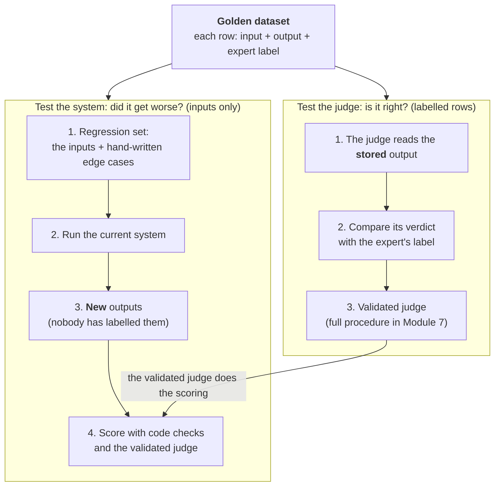

# Module 5. Build your first evals

!!! abstract "In this module"
    **You will learn:** how to turn each failure mode into an eval, choosing the cheapest grader that works; how one expert-labelled pool serves as both the golden dataset (to test judges) and the source of the regression set (to test the system); and how to write a narrow, binary judge prompt. This is Step 4 of the lifecycle.

    **Reading time:** about 15 minutes.

## Step 4: Build the first evals { #step-4 }

Turn each failure mode from [Module 4](04-error-analysis.md) into an eval: a code check, a classifier or a judge. Work from cheap to expensive, using this decision rule:

| Question | If yes |
|---|---|
| Can you write the check as an assertion with no false positives on 20 of your examples? | **Code check.** Use a regex, schema, SQL comparison, ID lookup, URL check or unit test on generated code. Runs in milliseconds, costs nothing. |
| Is there an existing classifier built for exactly this task (for example NLI for "is this claim supported?", a personal-data detector, a toxicity model), **and** does it reach your targets on about 50 of your labelled examples (a quick screen; full validation comes in [Module 7](07-validate-judges.md))? | **Pre-trained classifier.** Often cheaper and faster than an LLM. |
| Otherwise, is the failure something a careful reader could judge from the trace? | **One binary LLM judge per failure mode** (or a zero-shot decision model such as TypeSafe's Jev; see the note below), never one judge scoring "quality" ([Pitfall 1](10-pitfalls.md#pitfall-1)). Each rubric question counts as its own failure mode. |
| Is the failure rare, high-stakes or still hard to define? | **Human review** of a sampled slice until you can define it well enough to automate. |

*NLI* (natural language inference) models answer one question: "does passage A support statement B?". [Module 6](06-measuring-a-judge.md#classifier-spectrum) describes them and other pre-trained classifiers.

<a id="model-based-options"></a>

!!! note "Model-based options: classifiers, decision models and LLM judges"
    For the two model-based rows, an LLM judge is not the only choice. Alongside pre-trained classifiers there are **zero-shot decision models**: small models that take a yes/no question and return a verdict with a probability. [Module 6](06-measuring-a-judge.md#decision-models) names example products. Pick by what your failure mode needs:

    | | Pre-trained classifier | Zero-shot decision model | LLM judge |
    |---|---|---|---|
    | **Cost per check** | Low | Low | Usually the highest |
    | **Speed** | Fastest | Often fast | Slowest |
    | **Flexibility** | Low: only the one task it was trained for | Medium: any yes/no question you can state, but weaker on broad knowledge and multi-step reasoning | Highest: almost anything you can describe clearly |
    | **Gives a reason** | No | Usually not, just a verdict and probability | Yes, if you ask for one; useful when debugging |
    | **Returns a score you must threshold** | Yes | Yes | No, if it returns only PASS or FAIL |
    | **Setup effort** | Find a model that matches your task exactly, run it, then tune the threshold | Write the question, then tune the threshold | Write the prompt, then iterate on it |

    There is no fixed cost order between the first two. A self-hosted pre-trained classifier is often the cheapest, but a decision model can cost less: it depends on the product, hosting and volume, and prices move fast. Compare them on your own expected volume.

    Whichever you choose, it is a **model-based eval**: a classifier that can be wrong. Validate it against expert labels ([Module 7](07-validate-judges.md)) before you trust it, and for the ones that return a score, tune the threshold ([Module 8](08-scores-and-thresholds.md#threshold)). [Module 6](06-measuring-a-judge.md#classifier-spectrum) describes each family in more detail.

## A worked example: one failure mode, from analysis to checks { #check-worked-example }

Failure mode: `uses_current_policy`, from the trace in [Module 3](03-define-and-collect.md#step-2).

**(a) Code check.** The retrieved `doc_ids` must not include `policy-2022-refunds` (a superseded document). This is a code-based eval and catches this case with no model.

**(b) Judge prompt,** for cases code cannot catch (the answer states a wrong window with no stale document involved):

```text
You are checking exactly one thing: does the reply state the refund window
given in CURRENT_POLICY?

PASS: the reply states the same window as CURRENT_POLICY.
FAIL: the reply states a different window, invents an exception,
      or gives no window at all.

Reply with JSON, reason first: {"reason": "<one sentence>", "verdict": "PASS" | "FAIL"}

CURRENT_POLICY: {{current_policy}}
REPLY: {{reply}}
```

Notice what makes this prompt work: it checks **one** thing, it defines PASS and FAIL in observable terms, and it asks for a short reason before the verdict.

**(c) Expected result.** Run it on your labelled examples and compare with the expert ([Module 7](07-validate-judges.md)). The judge is not trusted until it matches.

## Split "quality" into binary checks

For a support bot that answers from retrieved documents, split one composite "Quality: 3.2/5" score into separate binary checks:

| Check | Grader | Pass criteria | Example failure |
|---|---|---|---|
| **Grounded in context** | Model (NLI model or LLM judge) | Every factual claim is supported by the retrieved context | Says "14-day refund window" but the context says 30 days |
| **Format compliance** | Code (regex) | Includes greeting, answer and disclaimer | Missing the required legal disclaimer |
| **Tone appropriate** | Model (classifier or LLM judge) | Matches the customer's emotional state | Cheerful response to an overcharge complaint |
| **No hallucinated URLs** | Code (HTTP HEAD request) | All referenced URLs return 200 | Links to a policy page that returns 404 |
| **Stays in scope** | Model (classifier or LLM judge) | Only answers billing questions | Billing bot gives medical advice |

"3 of 5 checks pass; two specific failures identified" points to specific fixes. "Quality: 3.2/5" tells you nothing you can act on.

**Done when:** every failure mode on your list has either a code check, a judge draft, or a documented reason for human review.

## One labelled pool, two uses { #labelled-data }

Your checks need data in two ways: to **test the judges** (is the judge right?) and to **test the system** (did a change make it worse?). You do not need two separate collections for this. Start from **one labelled pool** and use it in two ways.

### Start from one labelled pool { #labelled-pool }

The pool starts from the traces you read in error analysis ([Module 4](04-error-analysis.md)). Error analysis notes only the first thing that went wrong, so the expert then does a labelling pass that marks each trace pass or fail for each failure mode you will check (as in [Module 4's labelling table](04-error-analysis.md#labelling)). Each row holds:

- the **input** (the user's message and any context the system received);
- the system's **output** (the trace: the reply, retrieved documents, tool calls);
- the expert's **pass or fail label for one failure mode**, with a one-line **reason**.

This expert-labelled pool is your **golden dataset** (not to be confused with a "golden file" from snapshot testing).

### A label describes an output, not an input { #label-describes-output }

This is the key idea. The label "FAIL: says 14 days, policy says 30" is a fact about **one specific reply**. Change the prompt, the model or the documents and run the same input again, and you get a **new reply**. The old label says nothing about it: the new reply might be correct, or wrong in a new way.

So the pool has two uses:

- **The labelled rows (input, output, label) test the judge.** The judge reads the stored output, and you compare its verdict with the expert's label. The output never changes, so the label stays true.
- **The inputs re-run through the system form the regression set.** Each run produces new outputs, which nobody has labelled, so your **code checks and validated judges** score them. Add hand-written edge cases too: inputs you expect to be hard, even if you have not seen them fail yet.

Read the diagram from the top. The golden dataset splits into two separate uses, each a column of numbered steps. The **"Test the judge"** column uses the labelled rows. The **"Test the system"** column uses only the inputs. The one arrow between the columns is the link: the judge you validated in "Test the judge" scores the new outputs in "Test the system".



New production traces keep both columns up to date: see [Keep the pool alive](#keep-pool-alive) below.

That is why the golden dataset and the regression set overlap but are not the same thing: same inputs, different jobs. It is also why you need both. A green regression run is only as trustworthy as the judge that scored it, and the golden dataset is how you know the judge is trustworthy.

Do not expect every regression input to pass. Inputs whose failures you have not fixed yet are **capability cases**: track them, but do not gate on them. Once fixed, they become regression cases that must keep passing ([Pitfall 5](10-pitfalls.md#pitfall-5)). So compare each run with the last release input by input, not against 100%.

Some data *does* carry over to new outputs: anything that describes the correct answer for an input rather than a particular reply, such as the current policy text or the document IDs that should be retrieved. Store these alongside the input; reference-based checks use them on every run.

### Keep the pool alive { #keep-pool-alive }

The pool is not built once. It grows and gets corrected over the life of the system:

- **Online.** Periodically, the expert labels a small, fresh sample of live traces. Compare those labels with the judge's verdicts to re-check the judge in production, then add the rows to the pool as new labelled rows, assigned to a split so each split stays stratified. Rows you use to fix the judge belong to the dev set. A random production sample holds few failures (at a 5% failure rate, perhaps 2 or 3 in 50 rows), so judge the catch rate on bad outputs over several months or with a confidence interval, and add flagged or negative-feedback traces to get enough failures. Inputs of new failures join the regression set so CI catches them next time ([Module 9](09-run-and-monitor.md#step-7)).
- **When the policy changes** (concept drift), labels written under the old policy are wrong. The expert relabels the affected rows and you update the stored references *before* trusting any score ([Module 9](09-run-and-monitor.md#lifetime-regression)).
- **When the system's model changes**, the golden labels re-check the judge, and a fresh sample of the new model's outputs is labelled, because the new model writes differently ([Appendix A](appendix-a-model-migration.md)).

### Start simple { #start-simple }

One spreadsheet is enough: the [Module 4 labelling sheet](04-error-analysis.md#labelling) (`trace_id`, link, `input`, `output`, `failure_mode`, `label`, `reason`, `labeller`, `date`) plus two columns, `split` (few-shot, dev or test, explained below) and `source` (error analysis, production sample or edge case). One row per trace and failure mode.

You can start with code checks and a regression set alone. But label and record a split from the beginning, so the same rows let you validate judges and tune thresholds later without starting over.

Make your first labelled pool *hard*: include the failures and edge cases you found, not only easy traces. A suite of easy cases that always passes tells you nothing ([Pitfall 5](10-pitfalls.md#pitfall-5)).

<a id="splits"></a>

??? note "Looking ahead: splitting the pool for judge validation (Part 3)"
    TPR and TNR (the judge's pass rate on good outputs and catch rate on bad ones), thresholds and calibration are explained in Modules 6 to 8; come back here then.

    To test a judge honestly you must not tune it on the same rows you measure it on, so split the labelled rows ([Module 7](07-validate-judges.md#step-5) gives the full procedure):

    | Split | Share | Used for | Module |
    |---|---|---|---|
    | **Few-shot pool** | 10 to 20% | Examples you may paste into the judge prompt to show what pass and fail look like ([what it is for, with an example prompt](07-validate-judges.md#few-shot-pool)) | [7](07-validate-judges.md#few-shot-pool) |
    | **Dev set** | about 40 to 45% | Iterating on the judge prompt; for graders that return a score, also tuning the threshold and fitting calibration (cross-validation on this split) | [7](07-validate-judges.md#step-5), [8](08-scores-and-thresholds.md#threshold) |
    | **Test set** | about 40 to 45% | Measured **once** at the end to report TPR and TNR | [6](06-measuring-a-judge.md#tpr-tnr), [7](07-validate-judges.md#step-5) |

    **Stratify** each split: divide the passes and the fails separately, so every split gets its share of the rare failures.

    The **regression set may use inputs from all three splits**, test included. Running an input through the system and scoring the new output with the judge does not show the judge the expert's label, so nothing leaks into the judge. One caveat: inputs whose examples are pasted into the judge prompt can bias the judge on those cases, so read their verdicts with care, or leave the few-shot inputs out of the regression set.

<a id="data-worked-example"></a>

??? note "Worked example: the pool for one failure mode (read with Part 3)"
    The numbers are illustrative. The failure mode is `uses_current_policy` (the reply must state the current refund window), with the judge from the [worked example above](#check-worked-example).

    - **The pool.** The expert labels 200 traces. Failures are deliberately over-represented by pulling in flagged and negative-feedback traces ([Module 7](07-validate-judges.md#rare-failures)): 80 fail and 120 pass, so 40% fail.
    - **The splits**, stratified so each holds 40% failures:

        | Split | Rows | Fail | Pass |
        |---|:---:|:---:|:---:|
        | Few-shot pool | 30 | 12 | 18 |
        | Dev set | 85 | 34 | 51 |
        | Test set | 85 | 34 | 51 |
        | **Total** | **200** | **80** | **120** |

        The test set has 34 fails and 51 passes, which meets Module 7's guide of at least 30 to 50 of each class.

    - **The regression set** is all 200 inputs plus 25 hand-written edge cases (customers quoting the old window, questions about exceptions, refunds just past the deadline): 225 inputs in total.
    - **The judge.** You pick a few examples from the few-shot pool for the prompt, iterate on the 85 dev rows until TPR and TNR stop improving, then run the 85 test rows once and report TPR and TNR.
    - **A system prompt change.** You run the 225 regression inputs through the changed system. The code check (no superseded document retrieved) and the validated judge score the 225 new replies, and you compare the results with the last release, input by input. The 200 labels are not used to score these replies: they describe the old replies. The judge did not change, so a small prompt change does not need full re-validation; for a large change that alters the reply style, spot-check the judge on a few freshly labelled new replies (as in [Appendix A](appendix-a-model-migration.md)).
    - **A policy change** (the window goes from 60 to 30 days). You update the stored current-policy text first. The expert then relabels every row whose verdict depends on the window, because a reply that said "60 days" used to pass and now fails. You re-check the judge against the relabelled test rows. If it now misses its targets, fix it on the relabelled dev rows. Because the test rows have already been seen, confirm the fixed judge on a fresh labelled sample ([Module 7](07-validate-judges.md#step-5)) rather than trusting a second run on the same test rows. The 225 regression inputs stay as they are; only their references changed. Then you re-run them through the system.
    - **In production.** Every month (for example), the expert labels a fresh sample of live traces, topped up with flagged traces so it holds enough failures. If the judge's agreement on that sample drops, you re-validate it. The labelled rows join the pool as new labelled rows, assigned to a split so each split stays stratified, and any new kind of failure adds its input to the regression set.

## Key takeaways

- **One check per failure mode**, chosen from cheap to expensive: code, then a pre-trained classifier, then a binary LLM judge, then human review.
- Pre-trained classifiers, zero-shot decision models and LLM judges are all **model-based evals**: each must be validated against expert labels.
- Start from **one labelled pool**. The labelled rows (the **golden dataset**) test your judges; the **inputs**, plus edge cases, form the **regression set** that tests your system.
- A label describes **one specific output**. When the system changes, new outputs are scored by your checks and validated judges, not by the old labels.
- Record a **split** for each labelled row from the start (few-shot pool, dev set or test set, stratified), so the same rows can validate judges later in Part 3. The regression set may reuse inputs from every split.
- Regression inputs that still fail are **capability cases**; compare each run with the last release input by input, not against 100%.
- A good judge prompt checks **one thing**, defines PASS and FAIL in observable terms and gives a reason first.
- A judge is **not trusted** until it agrees with the expert on labelled examples.

## Check your understanding

??? question "A required legal disclaimer is missing from some replies. What kind of check do you build?"
    A code check, for example a regex for the disclaimer text. It is objectively checkable, so there is no need for a model.

??? question "What is the difference between the golden dataset and the regression set?"
    The golden dataset holds expert-labelled rows (input, output, label) used to test whether a judge is right. The regression set holds inputs you re-run on every change to test whether the system got worse. The regression set usually includes the golden dataset's inputs, plus edge cases.

??? question "You changed the system prompt. Why can you not score the new replies with the golden labels?"
    The labels describe the old replies. The same inputs now produce new replies, which nobody has labelled. Score them with your code checks and validated judges; the golden labels are for testing the judge.

??? question "Can the regression set include inputs from the judge's test set?"
    Yes. Re-running an input through the system and scoring the new output does not show the judge the expert's label, so nothing leaks. What you must not do is tune the judge on the test rows. The exception is the few-shot pool: those examples sit in the judge prompt and can bias it on the same inputs, so read their verdicts with care or leave them out.

??? question "You use a zero-shot decision model instead of an LLM judge because it is cheaper. What extra work does it need?"
    It returns a probability, so as well as validating it against expert labels you must tune its threshold ([Module 8](08-scores-and-thresholds.md#threshold)) and check calibration if you act on the probability as a confidence. An LLM judge that returns only PASS or FAIL has no threshold to tune.

??? question "Why not build one LLM judge that rates overall quality from 1 to 5?"
    The score is noisy and hard to validate, and it does not tell you what to fix. Separate binary checks, one per failure mode, point to the exact failure and can each be validated against expert labels.

**Next:** [Module 6. Measuring a judge](06-measuring-a-judge.md)
