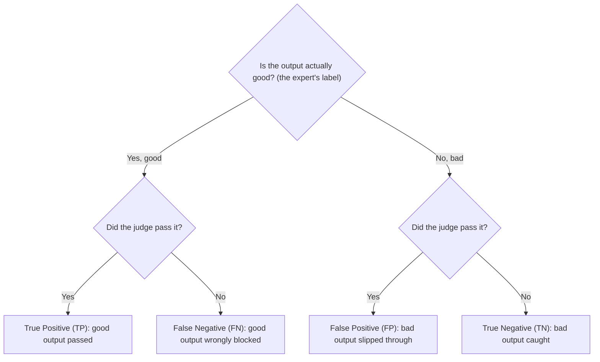

# Module 6. Measuring a judge

!!! abstract "In this module"
    **You will learn:**

    - the three families of model-based judge, and when to use each family
    - why "zero-shot" does not mean "no data work"
    - how to measure a judge with a confusion matrix, precision, recall, F1, TPR and TNR
    - why accuracy misleads on unbalanced data

    **Reading time:** about 15 minutes.

!!! tip "Part 3 is the hardest part of the course"
    Modules 6 to 8 take most of their ideas from data science and machine learning (ML) engineering. Examples are confusion matrices, held-out test sets, calibration and thresholds. A **held-out test set** is a set of labelled examples that you keep separate and use only one time, at the end. If you come from software engineering, much of this material is new. It is normal if you do not understand all of it on the first read.

    **What you must remember:**

    - **Validate every judge against expert labels** before you trust its verdicts.
    - **Report TPR and TNR.** TPR shows how many good outputs the judge passes. TNR shows how many bad outputs the judge catches. Measure them one time, on the held-out test set.
    - **Thresholds are business decisions.** The product owner chooses the trade-off. You supply the measurements.

    **What you can read quickly now and read again later:** the details of each classifier family, F1, calibration charts, Platt scaling and the cross-validation recipe in Module 8. Calibration, Platt scaling and cross-validation are necessary only when your judge returns a score.

    If your organisation has a data scientist or an ML engineer, work with them on this part. These methods are routine for them. A short review of your splits and metrics can stop you from trusting a judge that you should not trust.

## Can you trust the judge? { #trust-the-judge }

**The trust question.** After you choose a model-based judge, you must answer one question: **can you trust its judgement?** This module and the next two modules give you the tools to answer it. Hamel Husain puts the wider problem this way: *verifying classifiers has become "a lost art in modern AI".* An **LLM judge** is an LLM that reads an output and gives a verdict on it. Teams build LLM judges and ship them, but they do not ask how they know that the judge is trustworthy.

!!! info "AI evals are not a new, unsolved problem"
    When you check an LLM judge, you do **classifier validation**. This validation uses labelled examples from experts, held-out test sets, precision and recall, and calibration. These methods are established machine learning practice. The new part is that you apply them to LLM outputs. The idea is simple: give the judge inputs whose correct answers you already know, and count how often it gets them right.

**Classifiers.** A **classifier** is any model that puts each input into one label from a fixed set of labels, for example PASS or FAIL. Every model-based judge is a classifier.

## The classifier spectrum { #classifier-spectrum }

Model-based classifiers have three families. The families have different trade-offs in cost, speed, flexibility and setup.

!!! info "LLM-as-judge"
    **What:** A full LLM (a frontier model from any major vendor) uses a prompt to score each output.

    **Pro:** This family is the most flexible. It can judge almost anything that you can describe clearly.

    **Con:** It is expensive and slow. It also has [known biases](10-pitfalls.md#pitfall-2).

!!! info "Decision models"
    **What:** Small models that return a typed verdict with a probability, instead of free text. A decision model is like a function that returns `(bool, confidence)`.

    **Pro:** Decision models are frequently faster and cheaper than a full LLM.

    **Con:** They are less flexible than an LLM judge. The products are also new. For examples, see [Decision models](#decision-models) below.

!!! info "Pre-trained ML classifiers"
    **What:** Open-weight models that are already trained on large labelled datasets for specific tasks. "Open-weight" means that you can download and run the model yourself. These models are openly available on hubs such as Hugging Face.

    **Examples:**

    - **NLI** (natural language inference) models, such as `facebook/bart-large-mnli`. They answer the question "does passage A support statement B?". Teams use them to test that the retrieved context supports a response.
    - Hallucination detectors, such as Vectara's HHEM.
    - Safety classifiers, such as Llama Guard, ShieldGemma and Granite Guardian.
    - **NER** (named entity recognition) models. They find names and email addresses in text.

    Hosted classifiers also retire, not only LLMs. For example, Google's Perspective API toxicity service shuts down on 31 December 2026. Do not build new work on it.

    **Pro:** These models are fast and cheap. They are frequently accurate for a narrow, well-defined problem.

    **Con:** This family is the least flexible. Each model does one fixed task. It is useful only when an existing model closely matches your task. Their model cards warn about prompt sensitivity, language coverage and adversarial weaknesses. For this reason, also measure each model against your own labels.

**Where to start.** Start with an LLM judge or a decision model, because neither one needs training data. There is one exception. If a well-tested pre-trained model already solves your exact problem, it is usually the faster and cheaper choice. [Module 5](05-build-checks.md#model-based-options) compares the three families side by side on cost, speed, flexibility and setup.

!!! note "Zero-shot does not mean no data work"
    Teams usually use LLM judges and decision models **zero-shot**. This means that nobody trains them on your task, so you do not do training. That is why they are attractive. But you still need expert-labelled data for these jobs:

    - **Validate** the judge on *your* task ([Module 7](07-validate-judges.md)).
    - If the judge returns a score (decision models, classifiers), **tune its [threshold](08-scores-and-thresholds.md#threshold)** for your trade-off. A **threshold** is the cut-off score that separates PASS from FAIL.
    - If you use the score as a probability, [check calibration](08-scores-and-thresholds.md#raw-score).

    A plain PASS/FAIL LLM judge has no threshold. For this judge, you use the labelled data to tune the prompt. **Few-shot** examples are examples that you paste into the prompt. They do not replace the labelled data. You still need separate, held-out labelled examples to measure the judge.

!!! example "When zero-shot falls short (illustrative, not a measured result)"
    You deploy a zero-shot classifier for tone detection on an insurance-claims chatbot. It works well on general customer service chat. But in your niche, it labels 40% of frustrated-but-polite claimants as "neutral". The cause is a sentence such as "I've been waiting three weeks for a decision". A general model reads this sentence as neutral, but in a claims context it shows frustration. You find this problem only when you run the classifier against expert-labelled examples from your own system.

### Decision models { #decision-models }

**Example products.** These are examples of decision model products:

- TypeSafe's Jev
- Perplexity's Decider
- Liquid AI's d1
- Cloudflare's Clef
- OpenAI's Decisions API

This category is new and changes quickly. Treat these products as examples of what a decision model looks like in practice, not as recommendations. When you choose, examine what is available.

**Limits.** Decision models give you a verdict, not an explanation. They are less suitable for judgements that need broad knowledge or multi-step reasoning. They are classifiers like all other classifiers, so all of this module applies to them:

- Measure precision and recall on your own labels.
- Tune the threshold. Do not accept the default of 0.5.
- Examine whether the probabilities are calibrated.

**A published test.** Hamel Husain and Antaripa Saha's post [How To Use Decision Models for Evals](https://hamel.dev/blog/posts/decision-model-evals/) (October 2026) shows exactly this process. Their test was small: 98 agent traces and one task. These were the results:

- Only three of the six model variants reached 80% precision and 80% recall at some threshold.
- Several variants needed recalibration.
- The model with the best score was also the most expensive.

The authors note that results change across tasks and datasets. For this reason, you measure on your own data.

### What does each family output? { #outputs }

| Family | What it outputs | Is the score a probability? |
|---|---|---|
| **LLM-as-judge** | Text: a verdict ("PASS" or "FAIL"). Some judges also return a number. This course does not recommend that number ([Pitfall 1](10-pitfalls.md#pitfall-1)). | No. Self-reported confidence from an LLM is usually too high. The values are bunched near the top of the scale (Xiong et al., 2023; see also Tian et al., 2023). Treat it as an uncalibrated score and compare it with your labels. |
| **Decision models** | Typed decisions with probability scores. | Not automatically. In Husain and Saha's test, some models were well calibrated and others were not. Test them against your own labels. |
| **ML classifiers** | A raw internal number for each class, called a *logit*. A function converts the logit to a score between 0 and 1 ([Module 8](08-scores-and-thresholds.md#raw-score)). | Not by default. See [Module 8](08-scores-and-thresholds.md#raw-score). |

## The confusion matrix { #confusion-matrix }

**Four outcomes.** A **confusion matrix** counts the four ways in which a judge can be right or wrong. In this example, the judge's job is to flag pull requests (PRs) that have bugs. Thus, **"positive" means that the judge flagged a problem**. You give the judge 100 PRs that you already reviewed. Of these PRs, 40 had bugs and 60 were clean.

|  | Judge says "has bug" | Judge says "clean" |
|---|:---:|:---:|
| **Actually has a bug** | **35** True Positive (TP) | **5** False Negative (FN) |
| **Actually clean** | **10** False Positive (FP) | **50** True Negative (TN) |

| Metric | Formula | Result | In plain English |
|---|---|:---:|---|
| Accuracy | (TP + TN) / Total = (35 + 50) / 100 | **85%** | The judge classifies 85 of 100 PRs correctly |
| Precision | TP / (TP + FP) = 35 / 45 | **77.8%** | When the judge says "bug", it is right approximately 78% of the time |
| Recall | TP / (TP + FN) = 35 / 40 | **87.5%** | The judge catches 87.5% of the real bugs |
| F1 | 2 × (P × R) / (P + R) | **82.4%** | One balanced number that combines precision and recall |

-   **Precision: "When it flags, is it right?"**

    ---

    Of the 45 flagged PRs, 35 really had bugs and 10 were false alarms. A high-precision judge gives few false alarms.

-   **Recall: "Does it catch everything?"**

    ---

    Of the 40 PRs with bugs, the judge caught 35 and missed 5. A high-recall judge rarely misses a real problem. But it can also flag clean PRs (false alarms).

**The trade-off.** You cannot make both numbers as high as possible at the same time. If you increase recall, you accept more false alarms, and precision decreases. If you increase precision, you miss more real problems. **Why it matters:** the decision about which mistake costs more is a business decision. This decision sets how you tune the judge ([Module 8](08-scores-and-thresholds.md#threshold)).

### F1: one number that needs both { #f1 }

**Definition.** **F1** is a single number that is high only when **both** precision and recall are high. It is the *harmonic mean* of the two numbers: 2 × (P × R) / (P + R).

**Why not a normal average?** With a normal average, a strong number can hide a weak number. The harmonic mean moves towards the weaker of the two numbers:

| Precision | Recall | Normal average | F1 |
|:---:|:---:|:---:|:---:|
| 100% | 2% | 51% | **about 4%** |
| 95% | 50% | 72.5% | **about 65.5%** |
| 77.8% | 87.5% | 82.6% | **82.4%** (the PR judge above) |

**The first row.** The first row shows a judge that flags almost nothing. When it flags, it is right. But it catches only 2 bugs in 100. A normal average gives 51%. F1 gives approximately 4% (2 × 1.0 × 0.02 / 1.02), which is the honest answer.

**Why it matters:** with F1, you cannot hide a judge that misses half the problems behind high precision. If one type of mistake costs more than the other type, use a weighted version instead ([F-beta, Module 8](08-scores-and-thresholds.md#recipe)).

### TPR and TNR { #tpr-tnr }

**Two conventions.** The matrix above treats "has a bug" as the positive class, because the judge looks for problems. Eval write-ups usually give TPR and TNR with the **opposite** convention: *positive means that the output is good (the judge passes it)*. The next table shows the same 100 PRs from this point of view.

!!! warning "Watch the flip"
    "Positive" is a convention. The same table reads differently when you change which outcome you call positive. For this reason, always state your convention. Below, a **True Negative** is a *bad* PR that the judge correctly caught. This label reads backwards if you think of "positive" as "found a bug". If the technical names confuse you, use the plain names: **TPR = good-output pass rate**, **TNR = bad-output catch rate**.

**How to place a verdict.** To put one verdict in the matrix, ask two questions in this sequence. This diagram uses the **TPR/TNR convention** (positive = a good output, passed by the judge). It does not use the "positive = has a bug" convention of the first table.

TPR uses the left branch: TP / (TP + FN). TNR uses the right branch: TN / (TN + FP). Each rate looks at one type of output only.

|  | Judge passes | Judge fails |
|---|:---:|:---:|
| **Actually good (60)** | **50** True Positive: good PR correctly passed | **10** False Negative: good PR wrongly blocked |
| **Actually bad (40)** | **5** False Positive: bad PR slipped through | **35** True Negative: bad PR correctly caught |

- **TPR (true positive rate)** = 50 / (50 + 10) = **83.3%**. This rate is the share of the actually good outputs that the judge passes.
- **TNR (true negative rate)** = 35 / (35 + 5) = **87.5%**. This rate is the share of the actually bad outputs that the judge catches. It is the same number as "recall of the problem class" in the earlier table.

**Targets.** A common starting point is a TPR of at least 0.90 and a TNR of at least 0.85. This target comes from Jasmeet Kaur's playbook in the [references](references.md). It is not a published standard. Set your own targets from the cost of each type of mistake. Against those targets, this judge catches enough bad PRs (TNR 87.5%), but it wrongly blocks too many good PRs (TPR 83.3%).

**Better than chance.** As a minimum, a judge must be clearly better than chance, that is, TPR + TNR must be above 1. Why 1? A judge that always says PASS gets TPR 1 and TNR 0. A judge that flips a coin gets 0.5 and 0.5. Both sums are 1. A sum at or near 1 means that the judge's verdicts carry no information about the output.

**Why eval write-ups prefer TPR and TNR.** Precision changes with the **base rate**, that is, how common failures are. TPR and TNR do not change with the base rate. Your **golden dataset** is your set of expert-labelled examples. It intentionally contains a larger share of failures than production ([Module 7](07-validate-judges.md)). Thus, the precision that you measure on it is not the precision that you will see in production.

**An example of the effect.** Failures can be half of your golden dataset but only 5% of production traffic. In this case, many more of the judge's production flags will be false alarms than the golden dataset suggests. To estimate production precision, use one of these methods:

- Calculate precision again at the production failure rate.
- Measure precision on a random sample of production traces.

??? note "Side note: why not just report accuracy?"
    **Definition.** Accuracy is the share of all verdicts that the judge got right. It looks like the obvious number. But it misleads when good and bad outputs are unbalanced, and they usually are.

    **An example.** Take 100 outputs: 95 good and 5 bad. Think of a "judge" that passes everything and does not read the outputs. This judge gets the 95 good outputs right and the 5 bad outputs wrong:

    - **Accuracy:** 95 / 100 = **95%**. This result looks excellent.
    - **TPR:** 95 / 95 = **100%**. Every good output passed.
    - **TNR:** 0 / 5 = **0%**. The judge caught none of the bad outputs. Catching bad outputs is the job that you built it for.

    **Why TPR and TNR are better.** Accuracy mixes both types of output into one number, so the large class hides the small class. TPR and TNR look at **each class separately**. For this reason, a judge that ignores the rare class cannot hide: its TNR is 0. (TPR + TNR is 1, which is no better than chance, as above.) [Pitfall 5](10-pitfalls.md#pitfall-5) lists this problem among the common pitfalls, together with the vanity-suite trap.

## Key takeaways

- Every model-based judge is a **classifier**. When you check it, you do standard classifier validation.
- Choose between **LLM judges**, **decision models** and **pre-trained classifiers** by flexibility, cost and fit to your task.
- **Zero-shot removes the training, not the data work.** You still need expert labels to validate the judge. If the judge returns scores, you also need them to tune the threshold.
- Measure a judge with a **confusion matrix**. Report **TPR** (good outputs passed) and **TNR** (bad outputs caught), not [accuracy](#why-not-accuracy). With unbalanced data, accuracy hides a judge that misses the rare bad outputs.
- **F1** is high only when precision and recall are both high. So a strong number cannot hide a weak number.
- **State your convention.** "Positive" can mean "has a bug" or "good output". The same counts read differently under each convention.

## Check your understanding

??? question "A judge passes 98% of good outputs and catches 40% of bad ones. Is it good enough?"
    No. TPR is 0.98, but TNR is only 0.40. Most bad outputs get through. TPR + TNR is 1.38, so the judge is better than chance. But it is far below a starting target such as TNR 0.85.

??? question "A judge on 200 outputs (190 good, 10 bad) has 95% accuracy. It passes every output. What are its TPR and TNR?"
    TPR is 190 / 190 = 100% and TNR is 0 / 10 = 0%. The judge catches none of the bad outputs. Accuracy looked good only because bad outputs are rare.

??? question "Judge A has precision 90% and recall 90%. Judge B has precision 100% and recall 40%. Which has the higher F1, and why does that matter?"
    Judge A: F1 is 90%. Judge B: 2 × (1.0 × 0.4) / 1.4 is approximately 57%. But the normal average of its two numbers is 70%. Judge B misses most real problems, and F1 does not let its perfect precision hide this weakness.

??? question "Why can precision measured on your golden dataset mislead you about production?"
    Precision changes with how common failures are. The golden dataset intentionally contains a larger share of failures. In production, failures are rarer, so a larger share of the judge's flags will be false alarms.

??? question "You found a zero-shot decision model that looks good in the vendor's demo. What do you do before using it?"
    Do these steps before you use the model:

    1. Validate it on expert-labelled examples from your own system.
    2. Tune its threshold for your trade-off.
    3. If you will act on its probability, check its calibration.

**Next:** [Module 7. Validate your judges](07-validate-judges.md)
