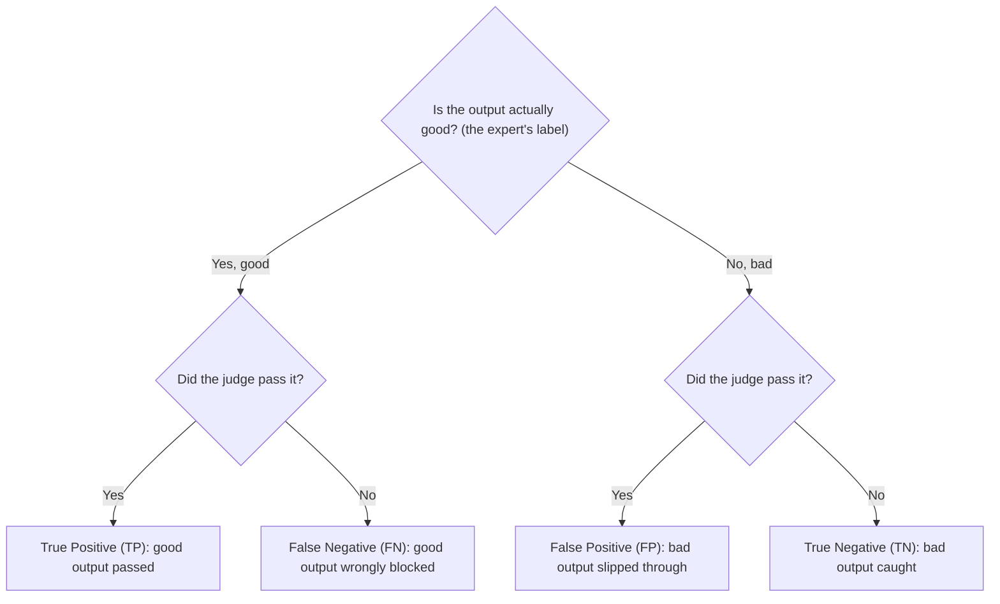

# Module 6. Measuring a judge

!!! abstract "In this module"
    **You will learn:** the three families of model-based grader and when to use each, why "zero-shot" does not mean "no data work", how to measure a judge with a confusion matrix, precision, recall, F1, TPR and TNR, and why accuracy misleads on unbalanced data.

    **Reading time:** about 15 minutes.

!!! tip "Part 3 is the hardest part of the course"
    Modules 6 to 8 borrow most of their ideas from data science and machine learning engineering: confusion matrices, held-out test sets (labelled examples you set aside and use only once, at the end), calibration, thresholds. If you come from software engineering, much of it will be new, and it is normal not to take it all in on the first read.

    **What you must take away:**

    - **Validate every judge against expert labels** before you trust its verdicts.
    - **Report TPR and TNR** (how many good outputs it passes, how many bad outputs it catches), measured once on the held-out test set.
    - **Thresholds are business decisions.** The product owner chooses the trade-off; you provide the measurements.

    **What you can skim and come back to:** the details of each classifier family, F1, calibration charts and Platt scaling, and the cross-validation recipe in Module 8. Calibration, Platt scaling and cross-validation matter only when your grader returns a score.

    If your organisation has a data scientist or ML engineer, pair with them for this part. These methods are routine for them, and a short review of your splits and metrics can stop you trusting a judge you should not.

## Can you trust the judge? { #trust-the-judge }

Once you have chosen a model-based grader, the question is: **can you trust its judgement?** This module and the next two give you the tools to answer that. Hamel Husain puts the wider problem this way: *verifying classifiers has become "a lost art in modern AI".* Teams build LLM judges and ship them without asking how they know the judge is trustworthy.

!!! info "AI evals are not a new, unsolved problem"
    Checking an LLM judge is **classifier validation**: labelled examples from experts, held-out test sets, precision and recall, calibration. The methods are established machine learning practice; what is new is applying them to LLM outputs. The idea is simple: you feed the judge inputs whose correct answers you already know, and count how often it gets them right.

A **classifier** is any model that assigns an input to one of a fixed set of labels, for example PASS or FAIL. Every model-based judge is a classifier.

## The classifier spectrum { #classifier-spectrum }

There are three families of model-based classifier, with different trade-offs in cost, speed, flexibility and setup.

!!! info "LLM-as-judge"
    **What:** A full LLM (a frontier model from any major vendor) scores each output using a prompt.

    **Pro:** The most flexible. It can judge almost anything you can describe clearly.

    **Con:** Expensive and slow, and subject to [known biases](10-pitfalls.md#pitfall-2).

!!! info "Decision models"
    **What:** small models that return a typed verdict with a probability, like a function returning `(bool, confidence)`, instead of free text.

    **Pro:** often faster and cheaper than a full LLM.

    **Con:** less flexible than an LLM judge; the products are new. See [Decision models](#decision-models) below for examples.

!!! info "Pre-trained ML classifiers"
    **What:** Open-weight models (you can download and run them yourself) already trained on large labelled datasets for specific tasks, freely available on hubs such as Hugging Face.

    **Examples:** **NLI** (natural language inference) models such as `facebook/bart-large-mnli`, which answer "does passage A support statement B?" and are used to test that a response is supported by the retrieved context; hallucination detectors such as Vectara's HHEM; safety classifiers such as Llama Guard, ShieldGemma and Granite Guardian; **NER** (named entity recognition) models that find names and emails in text. (Google's Perspective API toxicity service shuts down on 31 December 2026, so do not build new work on it: hosted classifiers are retired too, not just LLMs.)

    **Pro:** Fast, cheap and often accurate for a narrow, well-defined problem.

    **Con:** The least flexible: each model does one fixed task, so it is useful only when an existing model closely matches yours. Their model cards warn about prompt sensitivity, language coverage and adversarial weaknesses, so measure each against your own labels as well.

Start with an LLM judge or a decision model (no training data needed), unless a well-tested pre-trained model already solves your exact problem: then it is usually the faster, cheaper choice. [Module 5](05-build-checks.md#model-based-options) compares the three side by side on cost, speed, flexibility and setup.

!!! note "Zero-shot does not mean no data work"
    LLM judges and decision models are usually used **zero-shot**: nobody trains them on your task, so you skip training. That is their appeal. But you still need expert-labelled data to **validate** the grader on *your* task ([Module 7](07-validate-judges.md)) and, if it returns a score (decision models, classifiers), to **tune its [threshold](08-scores-and-thresholds.md#threshold)** for your trade-off and to [check calibration](08-scores-and-thresholds.md#raw-score) if you act on the score as a probability. A plain PASS/FAIL LLM judge has no threshold; its labelled data is used to tune the prompt instead. Examples you paste into the prompt (called **few-shot** examples) do not replace this: you still need separate, held-out labelled examples to measure the grader.

!!! example "When zero-shot falls short (illustrative, not a measured result)"
    You deploy a zero-shot classifier for tone detection on an insurance-claims chatbot. It works well on general customer service chat. But in your niche it labels 40% of frustrated-but-polite claimants "neutral", because "I've been waiting three weeks for a decision" reads as neutral to a general model and as frustration in a claims context. You only find this by running it against expert-labelled examples from your own system.

### Decision models { #decision-models }

Examples of decision model products include TypeSafe's Jev, Perplexity's Decider, Liquid AI's d1, Cloudflare's Clef, and OpenAI's Decisions API. This is a new, fast-moving category, so treat these as examples of what a decision model looks like in practice, not as recommendations; check what is available when you choose.

Decision models give you a verdict rather than an explanation, and are less suited to judgements that need broad knowledge or multi-step reasoning. They are classifiers like any other, so everything in this module applies: measure precision and recall on your own labels, tune the threshold instead of accepting the default 0.5, and check whether the probabilities are calibrated.

Hamel Husain and Antaripa Saha's post [How To Use Decision Models for Evals](https://hamel.dev/blog/posts/decision-model-evals/) (October 2026) walks through exactly this. In their small test (98 agent traces, one task), only three of the six model variants reached 80% precision and 80% recall at some threshold, several needed recalibration, and the best-scoring model was also the most expensive. The authors note that results vary across tasks and datasets, which is why you measure on your own data.

### What does each family output? { #outputs }

| Family | What it outputs | Is the score a probability? |
|---|---|---|
| **LLM-as-judge** | Text: a verdict ("PASS" or "FAIL"). Some judges also return a number, which this course discourages ([Pitfall 1](10-pitfalls.md#pitfall-1)). | No. Self-reported confidence from an LLM tends to be overconfident and bunched near the top of the scale (Xiong et al., 2023; see also Tian et al., 2023). Treat it as an uncalibrated score and check it against your labels. |
| **Decision models** | Typed decisions with probability scores. | Not automatically. In Husain and Saha's test some models were well calibrated and others were not. Test against your own labels. |
| **ML classifiers** | A raw internal number (a *logit*) per class, converted to a score between 0 and 1 ([Module 8](08-scores-and-thresholds.md#raw-score)). | Not by default. See [Module 8](08-scores-and-thresholds.md#raw-score). |

## The confusion matrix { #confusion-matrix }

A **confusion matrix** counts the four ways a judge can be right or wrong. In this example the judge's job is to flag buggy pull requests, so **"positive" means the judge flagged a problem**. You give it 100 PRs you have already reviewed: 40 had bugs and 60 were clean.

|  | Judge says "has bug" | Judge says "clean" |
|---|:---:|:---:|
| **Actually has a bug** | **35** True Positive (TP) | **5** False Negative (FN) |
| **Actually clean** | **10** False Positive (FP) | **50** True Negative (TN) |

| Metric | Formula | Result | In plain English |
|---|---|:---:|---|
| Accuracy | (TP + TN) / Total = (35 + 50) / 100 | **85%** | 85 of 100 PRs classified correctly |
| Precision | TP / (TP + FP) = 35 / 45 | **77.8%** | When it says "bug", it is right about 78% of the time |
| Recall | TP / (TP + FN) = 35 / 40 | **87.5%** | It catches 87.5% of the real bugs |
| F1 | 2 × (P × R) / (P + R) | **82.4%** | One balanced number combining precision and recall |

-   **Precision: "When it flags, is it right?"**

    ---

    Of the 45 PRs flagged, 35 really had bugs and 10 were false alarms. A high-precision judge raises few false alarms.

-   **Recall: "Does it catch everything?"**

    ---

    Of the 40 PRs with bugs, the judge caught 35 and missed 5. A high-recall judge rarely misses a real problem, but may flag things that are fine.

You cannot maximise both. Pushing recall up means accepting more false alarms (lower precision); pushing precision up means missing more real problems. **Why it matters:** which mistake costs more is a business question, and the answer sets how you tune the judge ([Module 8](08-scores-and-thresholds.md#threshold)).

### F1: one number that needs both { #f1 }

**F1** is a single number that is only high when **both** precision and recall are high. It is the *harmonic mean* of the two, 2 × (P × R) / (P + R).

Why not a normal average? A normal average lets a strong number hide a weak one. The harmonic mean is pulled towards the weaker of the two:

| Precision | Recall | Normal average | F1 |
|:---:|:---:|:---:|:---:|
| 100% | 2% | 51% | **about 4%** |
| 95% | 50% | 72.5% | **about 65.5%** |
| 77.8% | 87.5% | 82.6% | **82.4%** (the PR judge above) |

The first row is a judge that flags almost nothing. When it flags, it is right, but it catches only 2 bugs in 100. A normal average calls that 51%; F1 calls it about 4% (2 × 1.0 × 0.02 / 1.02), which is the honest answer. **Why it matters:** with F1 you cannot hide a judge that misses half the problems behind high precision. When one kind of mistake costs more than the other, use a weighted version instead ([F-beta, Module 8](08-scores-and-thresholds.md#recipe)).

### TPR and TNR { #tpr-tnr }

The matrix above treats "has a bug" as the positive class, because the judge is hunting for problems. Eval write-ups usually quote TPR and TNR with the **opposite** convention: *positive means the output is good (the judge passes it)*. Here are the same 100 PRs from that point of view.

!!! warning "Watch the flip"
    "Positive" is a convention: the same table reads differently depending on which outcome you call positive, so always state it. Below, a **True Negative** is a *bad* PR correctly caught, which reads backwards if you think of "positive" as "found a bug". If the jargon trips you up, use the plain names: **TPR = good-output pass rate**, **TNR = bad-output catch rate**.

To place any single verdict in the matrix, ask two questions in order. This diagram uses the **TPR/TNR convention** (positive = a good output, passed by the judge), not the "positive = has a bug" convention of the first table:

TPR uses the left branch: TP / (TP + FN). TNR uses the right branch: TN / (TN + FP). Each rate looks at one kind of output only.

|  | Judge passes | Judge fails |
|---|:---:|:---:|
| **Actually good (60)** | **50** True Positive: good PR correctly passed | **10** False Negative: good PR wrongly blocked |
| **Actually bad (40)** | **5** False Positive: bad PR slipped through | **35** True Negative: bad PR correctly caught |

- **TPR (true positive rate)** = 50 / (50 + 10) = **83.3%**. Of the genuinely good outputs, the share the judge passes.
- **TNR (true negative rate)** = 35 / (35 + 5) = **87.5%**. Of the genuinely bad outputs, the share the judge catches. This is the same number as "recall of the problem class" in the earlier table.

A common starting point is TPR of at least 0.90 and TNR of at least 0.85 (from Jasmeet Kaur's playbook in the [references](references.md); not a published standard). Set your own by the cost of each kind of mistake. Against those targets, this judge catches enough bad PRs (TNR 87.5%) but wrongly blocks too many good ones (TPR 83.3%).

At a minimum a judge must be clearly better than chance (TPR + TNR above 1). Why 1? A judge that always says PASS scores TPR 1 and TNR 0; a judge that flips a coin scores 0.5 and 0.5. Both add up to 1, so a sum at or near 1 means the judge's verdicts carry no information about the output.

**Why eval write-ups prefer TPR and TNR:** precision depends on how common failures are; TPR and TNR do not. Your golden dataset deliberately over-represents failures ([Module 7](07-validate-judges.md)), so the precision you measure on it is not the precision you will see in production. If failures are half of your golden dataset but 5% of production traffic, many more of the judge's production flags will be false alarms than the golden dataset suggests. To estimate production precision, recompute it at the production failure rate, or measure it on a random sample of production traces.

??? note "Side note: why not just report accuracy?"
    Accuracy is the share of all verdicts the judge got right. It sounds like the obvious number, but it misleads when good and bad outputs are unbalanced, which they usually are.

    Take 100 outputs: 95 good and 5 bad. A "judge" that passes everything without reading it gets the 95 good ones right and the 5 bad ones wrong:

    - **Accuracy:** 95 / 100 = **95%**. Looks excellent.
    - **TPR:** 95 / 95 = **100%**. Every good output passed.
    - **TNR:** 0 / 5 = **0%**. It caught none of the bad outputs, which is the job you built it for.

    Accuracy mixes both kinds of output into one number, so the large class drowns out the small one. TPR and TNR look at **each class separately**, so a judge that ignores the rare class cannot hide: its TNR is 0. (TPR + TNR is 1, which is no better than chance, as above.) [Pitfall 5](10-pitfalls.md#pitfall-5) lists this among common pitfalls, along with the vanity-suite trap.

## Key takeaways

- Every model-based judge is a **classifier**, and checking it is standard classifier validation.
- Choose between **LLM judges**, **decision models** and **pre-trained classifiers** by flexibility, cost and fit to your task.
- **Zero-shot skips training, not data work.** You still need expert labels to validate the grader and, for scores, to tune the threshold.
- Measure a judge with a **confusion matrix**. Report **TPR** (good outputs passed) and **TNR** (bad outputs caught), not [accuracy](#why-not-accuracy): with unbalanced data, accuracy hides a judge that misses the rare bad outputs.
- **F1** is high only when precision and recall are both high, so a strong number cannot hide a weak one.
- **State your convention.** "Positive" can mean "has a bug" or "good output"; the same counts read differently under each.

## Check your understanding

??? question "A judge passes 98% of good outputs and catches 40% of bad ones. Is it good enough?"
    No. TPR is 0.98 but TNR is only 0.40: most bad outputs slip through. TPR + TNR is 1.38, so it is better than chance, but far below a starting target such as TNR 0.85.

??? question "A judge on 200 outputs (190 good, 10 bad) has 95% accuracy. It passes every output. What are its TPR and TNR?"
    TPR is 190 / 190 = 100% and TNR is 0 / 10 = 0%. It catches none of the bad outputs. Accuracy looked good only because bad outputs are rare.

??? question "Judge A has precision 90% and recall 90%. Judge B has precision 100% and recall 40%. Which has the higher F1, and why does that matter?"
    Judge A: F1 is 90%. Judge B: 2 × (1.0 × 0.4) / 1.4 is about 57%, although the normal average of its two numbers is 70%. B misses most real problems, and F1 does not let its perfect precision hide that.

??? question "Why can precision measured on your golden dataset mislead you about production?"
    Precision depends on how common failures are. The golden dataset over-represents failures on purpose, so in production, where failures are rarer, a larger share of the judge's flags will be false alarms.

??? question "You found a zero-shot decision model that looks good in the vendor's demo. What do you do before using it?"
    Validate it on expert-labelled examples from your own system, tune its threshold for your trade-off, and check calibration if you will act on its probability.

**Next:** [Module 7. Validate your judges](07-validate-judges.md)
