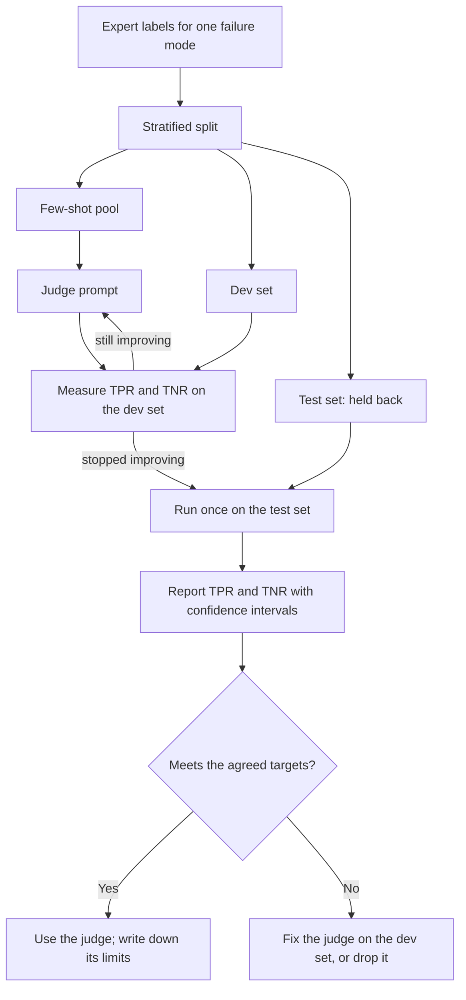

# Module 7. Validate your judges

!!! abstract "In this module"
    **You will learn:** the step-by-step procedure for testing a judge against expert labels, how many labels you need, and how to handle failures that are rare. This is Step 5 of the lifecycle, and it uses the metrics from [Module 6](06-measuring-a-judge.md).

    **Reading time:** about 10 minutes.

## Step 5: Validate your judges { #step-5 }

Any model-based grader is itself a classifier, and a classifier you have not measured is a guess. Before trusting a judge, test it against your golden dataset (the expert-labelled pool from [Module 5](05-build-checks.md#labelled-pool)) and measure how often it agrees with the expert.

| Stage | What you do | Why |
|---|---|---|
| **1. Get human labels** | Use the expert's pass or fail labels for **one failure mode** from the labelled pool. | This is the ground truth everything is measured against. |
| **2. Split the data** | Use the stratified **few-shot pool**, **dev set** and **test set** described in [Module 5](05-build-checks.md#splits). | Prevents **overfitting**: a judge tuned until it looks perfect on examples it has seen, which then fails on new ones. Each time you look at test-set results and tweak the prompt, the test set stops measuring how the judge does on new data. Examples pasted into the judge prompt come only from the few-shot pool, never from dev or test ([why](#few-shot-pool)). |
| **3. Iterate on the dev set** | Tune the judge prompt (including which [few-shot examples](#few-shot-pool) it shows) or model, measuring TPR and TNR each time. For a grader that returns a score, also tune the threshold and fit any calibration here, using cross-validation on the dev set ([Module 8](08-scores-and-thresholds.md#recipe)). | Find the configuration that best matches the expert, without touching the test set. |
| **4. Evaluate once on the test set** | Run the final judge on the test set; report [TPR and TNR](06-measuring-a-judge.md#tpr-tnr) with confidence intervals. | Confirms the judge generalises to data it has not seen. |
| **5. Report per-class rates, not accuracy** | Publish the confusion matrix and TPR/TNR (recall on each class). | [Accuracy hides class imbalance](06-measuring-a-judge.md#why-not-accuracy). |

The whole procedure as a picture. The rates use the TPR/TNR convention from [Module 6](06-measuring-a-judge.md#tpr-tnr): positive means a good output, passed.



If you fix a judge after seeing its test results, that test set has now influenced the judge. Treat the next result on it as optimistic, and confirm the fixed judge on freshly labelled examples, such as a new production sample.

### What the few-shot pool is for { #few-shot-pool }

**Few-shot examples** are a handful of labelled examples pasted into the judge prompt to show it what PASS and FAIL look like for this one failure mode. The most useful ones are the borderline cases your labelling guide had to settle, because those are where the judge is most likely to misread the rule. When you split the pool, put those borderline cases in the few-shot pool. A guide case that has landed in dev or test cannot go in the prompt.

**Why a separate pool.** The judge has seen those examples, so measuring it on them would inflate its score, like grading a student on the worked questions printed in the textbook. So few-shot examples come only from the few-shot pool, never from the dev set or the test set. The pool holds more rows than the prompt needs, so you have candidates to choose from and swap in while tuning. An example you write by hand also counts as part of the few-shot pool, and must never be copied into dev or test.

**How it is used while tuning.** Choosing which examples go in the prompt is part of prompt tuning. If the dev set shows the judge keeps getting one kind of case wrong, add a matching example from the few-shot pool (or swap one out) and re-measure on the dev set to see whether it helped. The test set is still run once, at the end.

If a dev example teaches you something you want in the prompt, write a new example of the same pattern (not a paraphrase of the dev row) and add it to the few-shot pool, or move that row to the few-shot pool and remove it from the dev set. Never do this with a test row.

**Keep it short.** A handful of examples, with both PASS and FAIL, is usually enough. More examples make the prompt longer and slower, and the judge may start copying surface patterns (wording, length) instead of applying the rule.

Here is the `uses_current_policy` judge from [Module 5](05-build-checks.md#check-worked-example) with an examples section added: two PASSes worded differently, and two FAILs, one stating the old 60-day window and one inventing an exception.

```text
You are checking exactly one thing: does the reply state the refund window
given in CURRENT_POLICY?

PASS: the reply states the same window as CURRENT_POLICY.
FAIL: the reply states a different window, invents an exception,
      or gives no window at all.

Reply with JSON, reason first: {"reason": "<one sentence>", "verdict": "PASS" | "FAIL"}

EXAMPLES

Example 1
CURRENT_POLICY: Refunds are available within 30 days of purchase.
REPLY: You can request a refund within 30 days of buying the item.
{"reason": "The reply states a 30-day window, matching the policy.", "verdict": "PASS"}

Example 2
CURRENT_POLICY: Refunds are available within 30 days of purchase.
REPLY: Our policy gives you 30 days from purchase to request a refund.
{"reason": "The reply states a 30-day window in different words, matching the policy.", "verdict": "PASS"}

Example 3
CURRENT_POLICY: Refunds are available within 30 days of purchase.
REPLY: No problem, you have 60 days from purchase to ask for a refund.
{"reason": "The reply states 60 days; the policy says 30 days.", "verdict": "FAIL"}

Example 4
CURRENT_POLICY: Refunds are available within 30 days of purchase.
REPLY: Refunds are available within 30 days, or 90 days for loyalty members.
{"reason": "The reply adds a 90-day exception for loyalty members that the policy does not contain.", "verdict": "FAIL"}

Now judge this case.
CURRENT_POLICY: {{current_policy}}
REPLY: {{reply}}
```

Example 4 is the borderline case: it states the correct window, so a careless reader would pass it, but the invented exception makes it a FAIL under the rule.

Few-shot examples are optional. Start zero-shot (no examples, as in Module 5), and add them only if the dev set shows the judge misreading a pattern.

## How many labels?

The binding constraint is the number of examples of the *rarer* class in your test set. As rules of thumb (from Hamel Husain's guidance, not hard rules):

- Aim for roughly **100 to 200 labelled examples per failure mode**.
- Have **at least 30 to 50 true passes and 30 to 50 true fails in the test set**. With the [Module 5 split shares](05-build-checks.md#splits) the test set is under half the pool, so 30 of each class in the test set needs roughly 140 labels even at a 50/50 balance: aim for the upper end of the range, and over-sample failures.
- Below about 60 labels in total, the confidence intervals are usually too wide to trust.

A **confidence interval** is a range of plausible values for the true rate, given how few examples you measured. With 20 labels, a measured 90% agreement is consistent with a true rate anywhere from about 70% to 97%. Report a confidence interval with every metric.

**Why it matters:** in [Module 9](09-run-and-monitor.md#step-6) you will set a release gate with a margin. If that margin is smaller than the confidence interval, the gate passes bad releases and blocks good ones by luck.

## When failures are rare { #rare-failures }

If failures are rare (say 5%), a random sample will not contain enough of them. This is called **class imbalance**: one outcome is much rarer than the other.

**Do not sample randomly for the golden dataset.** Pull in traces with negative feedback, flagged traces and previous failures, and write or generate extra failing examples with the expert. Then stratify the split ([Module 5](05-build-checks.md#splits)) so the dev set and the test set each get their share of the rare failures. A test set with three failures cannot tell you whether the judge catches failures. [Module 5's worked example](05-build-checks.md#data-worked-example) shows the numbers for one failure mode.

Because this over-samples failures, precision measured on the golden dataset will not match production ([why](06-measuring-a-judge.md#tpr-tnr)). TPR and TNR are not affected.

## Validation is not one-off { #revalidate }

A judge validated at launch can drift, and so can what your experts consider "good". Fresh expert labels on a sample of production traces re-check the judge and join the pool as new labelled rows, assigned to a split so each split stays stratified ([Module 5](05-build-checks.md#keep-pool-alive)). A random production sample holds few failures, so top it up with flagged traces or read the catch rate over several samples. [Module 9](09-run-and-monitor.md#step-7) lists when to re-validate.

**Done when:** each judge has a reported TPR and TNR on a held-out test set that was used once, meets the targets your product owner agreed, and its limits are written down. Judges that miss the targets are fixed or dropped.

## Key takeaways

- **A judge you have not measured is a guess.** Validate each judge against expert labels, one failure mode at a time.
- **Split the labels**, stratified ([Module 5](05-build-checks.md#splits)): a few-shot pool, a dev set to iterate on (prompt, and for scores also threshold and calibration), and a test set you use once.
- **Few-shot examples** in the judge prompt come only from the few-shot pool. Start zero-shot and add a few examples, both PASS and FAIL, only if the dev set shows the judge misreading a pattern.
- Count labels by the **rarer class**: aim for at least 30 to 50 passes and 30 to 50 fails in the test set, and report **confidence intervals**.
- When failures are rare, **collect extra failures on purpose** and stratify the split.
- **Re-check the judge** with fresh expert labels from production; those labels also grow the pool.

## Check your understanding

??? question "You tuned a judge prompt until it scored 100% on your test set. What went wrong?"
    You used the test set for tuning, so it no longer measures performance on new data. The judge may be overfitted. Tune on the dev set and touch the test set only once, at the end.

??? question "Your test set has 200 examples but only 4 failures. Can you trust the judge's TNR?"
    No. With 4 failures, TNR can only be 0%, 25%, 50%, 75% or 100%, and the confidence interval is huge. Collect more failing examples and stratify the split.

??? question "Can examples you paste into the judge prompt also be in the test set?"
    No. The judge has already seen them, so they would inflate its score. Keep the few-shot pool separate from the test set.

??? question "On the dev set, your judge keeps passing replies that state the right window but add an invented exception. A dev row shows this perfectly. Can you paste it into the prompt?"
    Not while it stays in the dev set, or the dev set would measure the judge on an example it has seen. Write a new example of the same pattern (not a paraphrase of the dev row) and add it to the few-shot pool, or move that row to the few-shot pool and remove it from the dev set, then re-measure on the dev set. See [the few-shot pool](#few-shot-pool).

??? question "Your grader is a decision model that returns a probability. On which split do you tune its threshold?"
    On the dev set, using cross-validation, together with any calibration you fit. Then run the chosen judge and threshold once on the test set to report TPR and TNR.

**Next:** [Module 8. Scores, calibration and thresholds](08-scores-and-thresholds.md)
