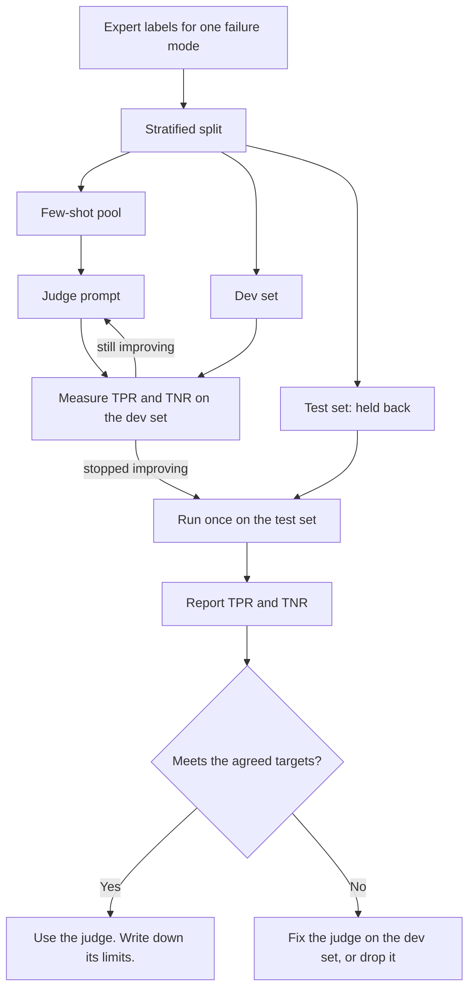

# Module 7. Validate your judges

!!! abstract "In this module"
    **You will learn:**

    - the step-by-step procedure to test a judge against expert labels
    - how many labels you need
    - what to do when failures are rare

    This module is Step 5 of the lifecycle. It uses the metrics from [Module 6](06-measuring-a-judge.md).

    **Reading time:** about 15 minutes.

## Step 5: Validate your judges { #step-5 }

**A judge is a classifier.** In this module, "judge" means any model-based grader: an LLM judge, a decision model or a pre-trained ML classifier ([Module 6](06-measuring-a-judge.md#classifier-spectrum)). Each of these judges is a classifier. A classifier that you have not measured is a guess.

**Test before you trust.** Before you trust a judge, test it against your golden dataset. The golden dataset is the expert-labelled pool from [Module 5](05-build-checks.md#labelled-pool). Measure how often the judge agrees with the expert.

| Stage | What you do | Why |
|---|---|---|
| **1. Get human labels** | Use the expert's pass or fail labels for **one failure mode** from the labelled pool. | These labels are the ground truth. You measure everything against them. |
| **2. Split the data** | Use the stratified **few-shot pool**, **dev set** and **test set** from [Module 5](05-build-checks.md#splits). | The split prevents **overfitting**. An overfitted judge is tuned until it looks perfect on examples that it has seen. Then it gets new examples wrong. Each time you examine the test-set results and change the prompt, the test set stops measuring performance on new data. Examples in the judge prompt come only from the few-shot pool, never from the dev set or the test set ([why](#few-shot-pool)). |
| **3. Iterate on the dev set** | Tune the judge prompt or the model. Prompt tuning includes the choice of the [few-shot examples](#few-shot-pool). Measure TPR and TNR after each change. If you need one number to compare versions and both types of mistake matter about equally, also use [F1](06-measuring-a-judge.md#f1). If the judge returns a score, also tune the threshold and fit any calibration here. Use cross-validation on the dev set for the threshold and the calibration ([Module 8](08-scores-and-thresholds.md#recipe)). | Find the configuration that agrees best with the expert. Do not touch the test set. |
| **4. Evaluate once on the test set** | Run the final judge on the test set. Report [TPR and TNR](06-measuring-a-judge.md#tpr-tnr). If the test set is small, also see [how sure the numbers are](#confidence-intervals) (optional). | This run confirms that the judge generalises to data that it has not seen. |
| **5. Report per-class rates, not accuracy** | Publish the confusion matrix and TPR/TNR (the recall on each class). | [Accuracy hides class imbalance](06-measuring-a-judge.md#why-not-accuracy). |

**The procedure as a diagram.** The diagram shows the full procedure. Follow the loop between the judge prompt and the dev set, and note that the test set joins only once. The rates use the TPR/TNR convention from [Module 6](06-measuring-a-judge.md#tpr-tnr): positive means a good output, passed.



**A fix after the test run.** If you fix a judge after you see its test results, that test set has influenced the judge. Thus, treat the next result on that test set as optimistic. Confirm the fixed judge on freshly labelled examples, for example a new production sample.

### What the few-shot pool is for { #few-shot-pool }

**Few-shot examples.** Few-shot examples are a small number of labelled examples in the judge prompt. They show the judge what PASS and FAIL look like for this one failure mode.

**Borderline cases.** The most useful few-shot examples are the borderline cases that your labelling guide had to settle. The judge is most likely to misread the rule on these cases. When you split the pool, put those borderline cases in the few-shot pool. If a guide case is already in the dev set or the test set, it cannot go in the prompt.

**Why a separate pool.** The judge has seen the few-shot examples. If you measure the judge on them, its score increases falsely. This error is like a test that grades a student on the worked questions in the textbook. For this reason, few-shot examples come only from the few-shot pool, never from the dev set or the test set.

**Size and hand-written examples.** The few-shot pool holds more rows than the prompt needs. You then have candidates to choose from and swap in during tuning. An example that you write by hand is also part of the few-shot pool. Never copy such an example into the dev set or the test set.

**Use during tuning.** The choice of examples for the prompt is part of prompt tuning. Use this procedure:

1. Measure the judge on the dev set.
2. If the dev-set results show that the judge keeps getting one kind of case wrong, add a matching example from the few-shot pool, or swap one out.
3. Measure the judge on the dev set again to see if the change helped.

Repeat steps 2 and 3 until the dev results stop improving. Run the test set only once, after tuning is complete.

**A useful dev example.** Sometimes a dev example teaches you something that you want in the prompt. In this case, do one of these two things:

- Write a new example of the same pattern and add it to the few-shot pool. Do not paraphrase the dev row.
- Move that row to the few-shot pool and remove it from the dev set.

Never use a test row in the prompt or in the few-shot pool.

**Keep it short.** A small number of examples, with both PASS and FAIL, is usually sufficient. More examples make the prompt longer and slower. Also, the judge can start to copy surface patterns (wording, length) instead of applying the rule.

**A worked example.** The prompt below is the `uses_current_policy` judge from [Module 5](05-build-checks.md#check-worked-example) with an examples section. The section has two PASS examples with different wording. It also has two FAIL examples. One FAIL states the old 60-day window. The other FAIL invents an exception.

```text
You are checking exactly one thing: does the reply state the refund window
given in CURRENT_POLICY?

PASS: the reply states the same window as CURRENT_POLICY.
FAIL: the reply states a different window, invents an exception,
      or gives no window at all.

Reply with JSON, reason first: {"reason": "<one sentence>", "verdict": "PASS" | "FAIL"}

EXAMPLES

Example 1
CURRENT_POLICY: Refunds are available within 30 days of purchase.
REPLY: You can request a refund within 30 days of buying the item.
{"reason": "The reply states a 30-day window, matching the policy.", "verdict": "PASS"}

Example 2
CURRENT_POLICY: Refunds are available within 30 days of purchase.
REPLY: Our policy gives you 30 days from purchase to request a refund.
{"reason": "The reply states a 30-day window in different words, matching the policy.", "verdict": "PASS"}

Example 3
CURRENT_POLICY: Refunds are available within 30 days of purchase.
REPLY: No problem, you have 60 days from purchase to ask for a refund.
{"reason": "The reply states 60 days; the policy says 30 days.", "verdict": "FAIL"}

Example 4
CURRENT_POLICY: Refunds are available within 30 days of purchase.
REPLY: Refunds are available within 30 days, or 90 days for loyalty members.
{"reason": "The reply adds a 90-day exception for loyalty members that the policy does not contain.", "verdict": "FAIL"}

Now judge this case.
CURRENT_POLICY: {{current_policy}}
REPLY: {{reply}}
```

**The borderline case.** Example 4 is the borderline case. It states the correct window, so a careless reader can pass it. But the invented exception makes it a FAIL under the rule.

**Start zero-shot.** Few-shot examples are optional. Start zero-shot, that is, with no examples, as in Module 5. Add examples only if the dev set shows that the judge misreads a pattern.

## How many labels?

**The rarer class sets the limit.** The number of examples of the *rarer* class in your test set is the binding constraint. These rules of thumb come from Hamel Husain's guidance. They are not hard rules.

- Aim for approximately **100 to 200 labelled examples per failure mode**.
- Have **at least 30 to 50 true passes and 30 to 50 true fails in the test set**. With the [Module 5 split shares](05-build-checks.md#splits), the test set is less than half of the pool. Thus, 30 of each class in the test set needs approximately 140 labels, even at a 50/50 balance. Aim for the upper end of the range, and over-sample failures.
- Below approximately 60 labels in total, the numbers are usually too uncertain to trust.

**Why the count matters.** With few labels, a measured rate can be far from the true rate, just by chance. Be careful when you compare two versions that differ by only a few points on a small test set.

<a id="confidence-intervals"></a>

??? note "Optional: how sure is a number from a small test set? (confidence intervals)"
    **You do not need this to start.** Read it when you must trust a number from a small test set, or a small difference between two versions.

    **What it is.** A **confidence interval** is the range in which the true rate probably lies, given how many examples you measured. Fewer examples give a wider range. For example, a judge agrees with the expert on 18 of 20 labels: that is 90%, but the true rate can be anywhere from approximately 70% to 97%. With 180 of 200 labels, the rate is again 90%, and the range is approximately 85% to 93%.

    **When it is worth a check:**

    - Your test set is small. Golden datasets of 100 to 200 labels are small in this sense.
    - Two versions differ by only a few points, for example "TNR went from 84% to 88%".
    - You set a release-gate margin ([Module 9](09-run-and-monitor.md#step-6)). If the margin is smaller than the range, the gate passes or blocks releases by luck.

    **How common it is.** In ML practice, most results, benchmarks and leaderboards report one number without a range. Hamel Husain mentions "reporting uncalibrated scores without confidence intervals" only briefly, in a list of pitfalls in *The Revenge of the Data Scientist*. Anthropic's paper *Adding Error Bars to Evals* (Evan Miller, 2024) argues that evals should report them, and shows that a 2-point gap between models on a benchmark of a few thousand items is often noise. Your test sets are much smaller, so the noise is larger.

    **A simple habit.** Before you trust a small number or a small difference, check how wide the range is. The calculator below does this in seconds. In code, use a Wilson score interval, which most statistics libraries provide.

??? example "Try it yourself: how wide is the interval?"
    Change the number of labels and see how wide the plausible range for the true rate is.

    **Try this:** press 180 of 200 and compare it with 18 of 20. The measured rate is the same 90%, but the interval shrinks from about 27 to about 8 percentage points.

    <div class="ew-widget" data-widget="confidence-interval" markdown>

    Interactive interval calculator (needs JavaScript). With 20 labels, a measured 90% agreement is consistent with a true rate from about 70% to 97%.

    </div>

## When failures are rare { #rare-failures }

**Class imbalance.** If failures are rare (for example, 5%), a random sample will not contain sufficient failures. This problem is called **class imbalance**: one outcome is much rarer than the other.

**Do not sample randomly for the golden dataset.** Collect likely failures on purpose from these sources:

- traces with negative feedback
- flagged traces
- previous failures
- extra failing examples that you write or generate with the expert

**Stratify the split.** Stratify the split ([Module 5](05-build-checks.md#splits)) so that the dev set and the test set each get their share of the rare failures. A test set with three failures cannot tell you if the judge catches failures. [The worked example in Module 5](05-build-checks.md#data-worked-example) shows the numbers for one failure mode.

**The effect on precision.** This method over-samples failures. Thus, the precision that you measure on the golden dataset will not match production ([why](06-measuring-a-judge.md#tpr-tnr)). This method does not affect TPR and TNR.

## Validation is not one-off { #revalidate }

**Drift.** A judge that you validated at launch can drift. The meaning of "good" for your experts can also drift.

**Fresh labels.** Fresh expert labels on a sample of production traces re-check the judge. These labels also join the pool as new labelled rows. Assign each new row to a split, so that each split stays stratified ([Module 5](05-build-checks.md#keep-pool-alive)).

**Few failures in production samples.** A random production sample holds few failures. For this reason, add flagged traces to the sample, or read the catch rate over several samples. [Module 9](09-run-and-monitor.md#step-7) lists when to re-validate.

**Done when:** each judge meets all these conditions:

- It has a reported TPR and TNR on a held-out test set that you used once.
- It meets the targets that your product owner agreed.
- Its limits are written down.

Fix or drop the judges that miss the targets.

## Key takeaways

- **A judge that you have not measured is a guess.** Validate each judge against expert labels, one failure mode at a time.
- **Split the labels**, stratified ([Module 5](05-build-checks.md#splits)), into three parts:
    - a few-shot pool
    - a dev set to iterate on (the prompt, and for scores also the threshold and calibration)
    - a test set that you use once
- **Few-shot examples** in the judge prompt come only from the few-shot pool. Start zero-shot. Add a small number of examples, both PASS and FAIL, only if the dev set shows that the judge misreads a pattern.
- Count labels by the **rarer class**. Aim for at least 30 to 50 passes and 30 to 50 fails in the test set. With fewer labels, the numbers are uncertain.
- When failures are rare, **collect extra failures on purpose** and stratify the split.
- **Re-check the judge** with fresh expert labels from production. Those labels also make the pool larger.

## Check your understanding

??? question "You tuned a judge prompt until it scored 100% on your test set. What went wrong?"
    You used the test set for tuning. Thus, the test set no longer measures performance on new data, and the judge is probably overfitted. Tune on the dev set. Use the test set only once, at the end.

??? question "Your test set has 200 examples but only 4 failures. Can you trust the judge's TNR?"
    No. With 4 failures, TNR can only be 0%, 25%, 50%, 75% or 100%, and chance alone can move it a lot. Collect more failing examples and stratify the split.

??? question "Can examples you paste into the judge prompt also be in the test set?"
    No. The judge has already seen them, so they increase its score falsely. Keep the few-shot pool separate from the test set.

??? question "On the dev set, your judge keeps passing replies that state the right window but add an invented exception. A dev row shows this perfectly. Can you paste it into the prompt?"
    Not while the row stays in the dev set. If you do, the dev set measures the judge on an example that it has seen. Do one of these two things, then measure on the dev set again:

    - Write a new example of the same pattern and add it to the few-shot pool. Do not paraphrase the dev row.
    - Move that row to the few-shot pool and remove it from the dev set.

    See [the few-shot pool](#few-shot-pool).

??? question "Your grader is a decision model that returns a probability. On which split do you tune its threshold?"
    Tune the threshold and fit any calibration on the dev set. Use cross-validation for both. Then run the chosen judge and threshold once on the test set to report TPR and TNR.

**Next:** [Module 8. Scores, calibration and thresholds](08-scores-and-thresholds.md)
