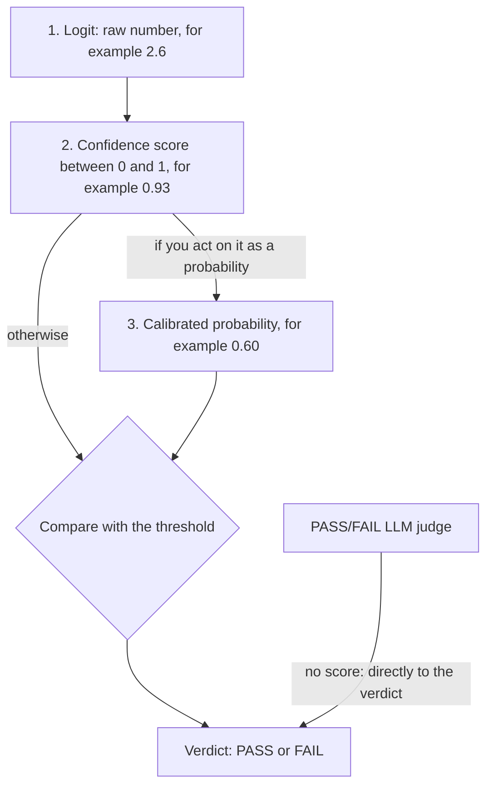
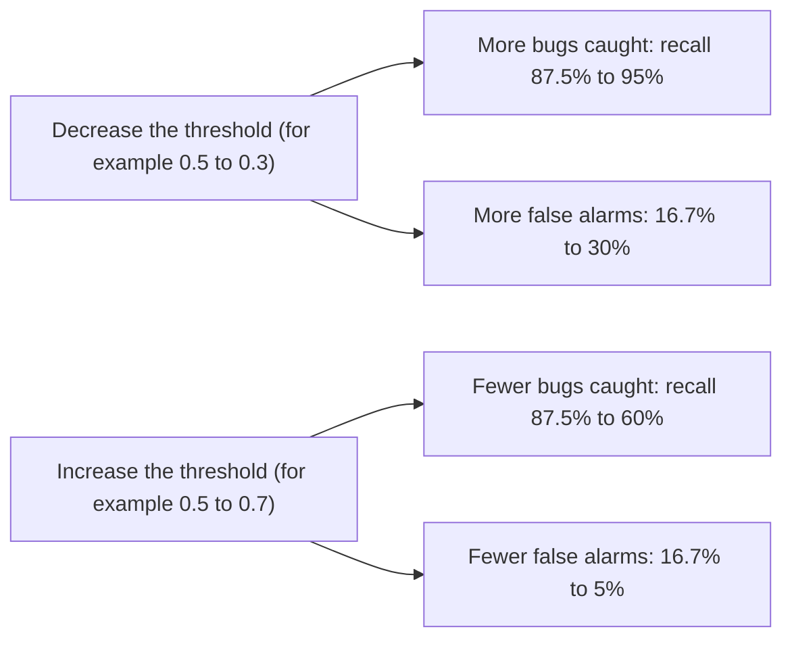

# Module 8. Scores, calibration and thresholds

!!! abstract "In this module"
    **You will learn:**

    - when you can trust a score between 0 and 1 as a probability
    - how to check calibration
    - how to choose the threshold that changes a score into a verdict

    **Reading time:** about 10 minutes.

    **Can I skip this?** If all your judges return only PASS or FAIL, skim this module. Those judges have no score to calibrate and no threshold to tune. Read the full module if you use decision models, ML classifiers or any classifier or judge that returns a number.

## From raw score to trustworthy probability { #raw-score }

A classifier gives you a **verdict** and a **score between 0 and 1**. If you act on that score (for example, "block when above 0.8"), the score must mean what it says. But the score may not mean what it says. A model can report 0.93 and be right only 60% of the time.

Calibration matters when you *act on a numeric score*. For example, you set a threshold on the probability from a classifier or a decision model. Calibration makes the score match how often the model is actually right. A judge that returns only PASS or FAIL has no probability to calibrate. To validate that judge, measure its TPR and TNR against human labels ([Module 7](07-validate-judges.md)).

The score goes through three stages before it has a meaning:

| Stage | Example | What it is |
|---|:---:|---|
| **1. Logit** | 2.6 | The model calculates this raw number internally. It has no limits: it can be negative or very large. You cannot interpret it by itself. |
| **2. Confidence score** | 0.93 | A squashing function (sigmoid or softmax) changes the logit into a value between 0 and 1. The value **has the shape of a probability, but nothing has checked it.** |
| **3. Calibrated probability** | 0.60 | [Calibration](glossary.md#calibration) is a statistical adjustment. You fit it on labelled data from the dev set, never the test set (see [Module 5](05-build-checks.md#splits)). After calibration, the score matches reality. In this example, predictions with a score of approximately 0.93 were right only approximately 60% of the time. Thus the calibrated value is 0.60. **Now you can trust the number.** |

The diagram below shows the same path as a picture. The path ends in a verdict. Look at the two arrows that leave the confidence score. You need calibration only if you act on the score as a probability. You can also set a threshold directly on the uncalibrated score. For this, use the TPR and TNR (or the precision and recall) that you measured.

The meaning of the score decides which side of the threshold is FAIL. In the pull-request example below, the score means "has a bug". Thus the system flags a pull request when its score is above the threshold.

{ width="420" }

To test calibration, do these steps:

1. Collect many predictions.
2. Put the predictions into buckets by the confidence that the model reported.
3. For each bucket, compare the reported confidence with how often the model was actually right.

The charts above show the result of this test. Compare the bars in each chart with the dashed diagonal. In the top chart, the bars are near the diagonal. In the bottom chart, the model reports 80 to 100% confidence but is right only 58% of the time. This gap is the calibration error.

**ECE (Expected Calibration Error)** is the average of these gaps across all buckets. Each gap counts in proportion to the number of predictions in its bucket. A lower ECE is better.

??? example "Try it yourself: calibration and ECE"
    It opens on the overconfident (bottom) chart. Slide towards 0 to reach the well-calibrated top chart, then back again, and watch the bars leave the diagonal and ECE grow.

    **Try this:** at each step, look at the table and find which bucket adds most to ECE. The top bucket holds half the predictions, so its gap dominates.

    

    Interactive calibration chart (needs JavaScript). In the overconfident example, the 80 to 100% bucket is right only 58% of the time.

    

If the scores are not calibrated, a common correction is **Platt scaling**. Platt scaling fits a smooth correction curve. The curve maps the model's score to the rate that you actually observed on labelled dev-set examples. Make sure that Platt scaling improves the results on your data. It does not always improve them.

## Threshold: a business decision, not a default { #threshold }

A **threshold** is a cut-off value. To change a numeric score into a verdict, you compare the score with the threshold. The default threshold is usually 0.5. If you use that default and do not check it, you can lose a lot of value.

The figures below are illustrative. They use the pull-request example from [Module 6](06-measuring-a-judge.md#confusion-matrix). In that example, positive means "has a bug". The 0.5 row matches Module 6: recall is 87.5% and the false-alarm rate is 10 / 60 = 16.7%.

The TPR/TNR convention uses the opposite direction: positive means a good output. In that convention, the recall of bugs is the TNR. The false-alarm rate is 1 minus the TPR. Thus the 0.5 row has a TNR of 87.5% and a TPR of 83.3%.

| Threshold | Bugs caught (recall) | False-alarm rate | Best when |
|---|---|---|---|
| **0.3** (low) | 95% | 30% | "Never miss a real bug": safety-critical systems, compliance |
| **0.5** (default) | 87.5% | 16.7% | Balanced default, not optimised for either direction |
| **0.7** (high) | 60% | 5% | "Only flag when very sure": low-noise settings, user-facing alerts |

The diagram below shows the trade-off in the table. Follow each arrow. When you decrease the threshold, recall and the false-alarm rate both increase or stay the same. You cannot get more caught bugs without the risk of more false alarms.

??? example "Try it yourself: move the threshold"
    Drag the threshold over 100 illustrative PR scores and watch recall and false alarms move together.

    **Try this:** find the lowest threshold that keeps the false-alarm rate under 10%. How much recall do you give up compared with 0.5?

    

    Interactive threshold explorer (needs JavaScript). At 0.3: recall 95%, false alarms 30%. At 0.5: 87.5% and 16.7%. At 0.7: 60% and 5%.

    

Thresholds apply to all graders and models that return a numeric score. Examples are ML classifiers, decision models and G-Eval in its default, non-strict mode (see [Module 11](11-tools.md)). A pure PASS/FAIL LLM judge has no threshold to tune. Tune its prompt instead.

The correct row is not a technical decision. It depends on which costs your business more: a missed problem or a false alarm. For this reason, **the product owner decides**. The product owner uses the measurements that you supply.

### A practical recipe { #recipe }

Hamel Husain and Antaripa Saha wrote a post about decision models. The post gives a practical recipe. The recipe is standard classifier evaluation:

1. Finalise the judge prompt. Then set the **minimum precision and recall** for your use case. The product owner decides these values. Reject the models that do not reach them.

2. **Tune each model's threshold on labelled data before you compare models.** Husain and Saha use cross-validation. In the terms of this course, do it on the **dev set** ([Module 5](05-build-checks.md#splits)):

    1. Divide the dev set into several parts.
    2. Tune on all parts but one.
    3. Measure on the part that you left out.
    4. Rotate the parts and calculate the average.

    With this method, one lucky split does not decide the result. Then confirm the chosen threshold one time on your test set.

3. **Choose a metric that matches your costs.** F-beta is F1 with a weighting control. With beta = 2, recall (missed failures) counts more than precision (false alarms). With beta = 0.5, precision counts more than recall. Choose beta to match your costs. Do not use F1 (beta = 1) automatically.

4. If you use scores as confidences, check calibration. Test whether Platt scaling actually helps. Fit Platt scaling on the dev set too.

5. Find the best balance between performance and **cost and latency**. A better model can be too slow or too expensive.

6. Iterate. After a prompt change, measure the threshold again. It can need a new value. Make a separate judge for each failure mode.

## Key takeaways

- **A score between 0 and 1 is not automatically a probability.** Check calibration before you act on the score as a probability.
- To test calibration, **put predictions into buckets by confidence**. Then compare each bucket with how often the model was right.
- The **threshold** sets the trade-off between missed problems and false alarms. It is a **business decision**. Do not accept 0.5 automatically as the default.
- **Tune thresholds and fit calibration on the dev set** (with cross-validation). Then confirm one time on the test set.
- PASS/FAIL judges have no threshold or probability. Validate them with TPR and TNR.

## Check your understanding

??? question "A classifier gives a score of 0.95 to a set of outputs, but only 70% of those outputs are actually bad. What is wrong?"
    The classifier is overconfident. Its scores are not calibrated. You cannot read 0.95 as a 95% probability. Calibrate the classifier on labelled dev-set examples ([Module 5 splits](05-build-checks.md#splits)). Or, set the threshold from the precision and recall that you measured, not from the raw number.

??? question "Your system screens messages for self-harm. Each self-harm message must go to a human. Do you decrease or increase the threshold?"
    Decrease it. A lower threshold catches more real cases (higher recall), but it also gives more false alarms. A missed real case costs much more than an unnecessary escalation. The product owner should confirm this trade-off.

??? question "A colleague fitted Platt scaling and chose the threshold on the test set. Then the colleague reported TPR and TNR on that same test set. What is wrong?"
    The colleague used the test set for tuning. Thus the reported rates are optimistic. The colleague fitted the threshold and calibration to those exact rows. Fit both on the dev set with cross-validation. Then measure one time on the test set.

??? question "Your LLM judge returns only PASS or FAIL. Does it need calibration?"
    No. It has no score to calibrate and no threshold to tune. Validate it with TPR and TNR against expert labels. Also tune its prompt.

**Next:** [Module 9. Run, monitor and re-run](09-run-and-monitor.md)
