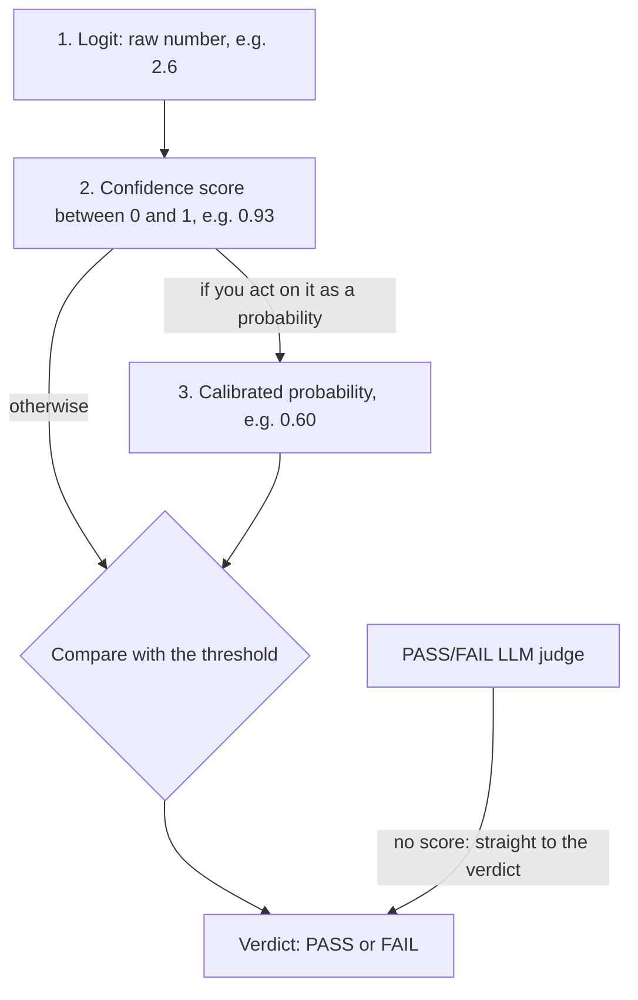

# Module 8. Scores, calibration and thresholds

!!! abstract "In this module"
    **You will learn:** when a score between 0 and 1 can be trusted as a probability, how calibration is checked, and how to choose the threshold that turns a score into a verdict.

    **Reading time:** about 5 minutes.

    **Can I skip this?** If all your judges return only PASS or FAIL, skim this module: those judges have no score to calibrate and no threshold to tune. Read it in full if you use decision models, ML classifiers or any grader that returns a number.

## From raw score to trustworthy probability { #raw-score }

A classifier gives you a **verdict** and a **score between 0 and 1**. If you act on that score (for example "block when above 0.8"), you need it to mean what it says, and it may not: a model can report 0.93 and be right only 60% of the time.

Calibration matters when you *act on a numeric score*, for example by setting a threshold on a classifier or decision-model probability. A judge that returns only PASS or FAIL has no probability to calibrate; you validate it with TPR and TNR against human labels ([Module 7](07-validate-judges.md)).

The score passes through stages before it means anything:

| Stage | Example | What it is |
|---|:---:|---|
| **1. Logit** | 2.6 | A raw number the model produces internally. Unbounded: it can be negative or very large. Not interpretable by itself. |
| **2. Confidence score** | 0.93 | A squashing function (sigmoid or softmax) converts the logit to a value between 0 and 1. It **has the shape of a probability, but nothing has checked it.** |
| **3. Calibrated probability** | 0.60 | After [calibration](glossary.md#calibration) (a statistical adjustment fitted on labelled data from the dev set, never the test set; see [Module 5](05-build-checks.md#splits)) the score matches reality. In this example, predictions that scored about 0.93 were right only about 60% of the time, so the calibrated value is 0.60. **Now you can trust the number.** |

The same path as a picture, ending in a verdict. Calibration is needed only if you act on the score as a probability; a threshold can also be set directly on the uncalibrated score from measured TPR and TNR (or precision and recall).

Which side of the threshold means FAIL depends on what the score measures. In the pull-request example below the score means "has a bug", so a score above the threshold is flagged.

{ width="420" }

To test calibration, take many predictions, group them into buckets by the confidence the model reported, and compare each bucket with how often the model was actually right. In the top chart the bars sit near the diagonal. In the bottom chart the model reports 80 to 100% confidence but is right only 58% of the time; that gap is the calibration error. **ECE (Expected Calibration Error)** averages these gaps across buckets, weighted by how many predictions each holds; lower is better.

If the scores are off, a common correction is **Platt scaling**: fit a smooth correction curve that maps the model's score to the rate actually observed on labelled dev-set examples. Check that it actually improves things on your data; it does not always.

## Threshold: a business decision, not a default { #threshold }

A numeric score becomes a verdict by comparing it with a **threshold**, usually 0.5 by default. Using that default without checking can leave a lot on the table.

The figures below are illustrative and use the pull-request example from [Module 6](06-measuring-a-judge.md#confusion-matrix), where positive means "has a bug". The 0.5 row matches it: recall 87.5%, false-alarm rate 10 / 60 = 16.7%. In the TPR/TNR convention (positive = good output), recall of bugs is the TNR and the false-alarm rate is 1 minus the TPR, so the 0.5 row is TNR 87.5% and TPR 83.3%.

| Threshold | Bugs caught (recall) | False-alarm rate | Best when |
|---|---|---|---|
| **0.3** (low) | 95% | 30% | "Never miss a real bug": safety-critical systems, compliance |
| **0.5** (default) | 87.5% | 16.7% | Balanced default, not optimised for either direction |
| **0.7** (high) | 60% | 5% | "Only flag when very sure": low-noise settings, user-facing alerts |

A threshold applies to anything that returns a numeric score (ML classifiers, decision models, or G-Eval in its default, non-strict mode; see [Module 11](11-tools.md)). A pure PASS/FAIL LLM judge has no threshold to tune; tune its prompt instead.

Which row is right is not a technical question. It depends on whether a missed problem or a false alarm costs your business more, so **the product owner decides**, using the measurements you provide.

### A practical recipe { #recipe }

Hamel Husain and Antaripa Saha's decision-model post gives a practical recipe, which is standard classifier evaluation:

1. Finalise the judge prompt, then set **minimum precision and recall** for your use case (the product owner decides), and rule out models that miss them.
2. **Tune each model's threshold on labelled data before comparing models.** Husain and Saha use cross-validation. In this course's terms, do it on the **dev set** ([Module 5](05-build-checks.md#splits)): divide it into several parts, tune on all but one, measure on the part left out, rotate and average, so one lucky split does not decide. Then confirm the chosen threshold once on your test set.
3. **Pick a metric that matches your costs.** F-beta is F1 with a weighting knob: with beta = 2, recall (missing failures) counts more than precision (false alarms); with beta = 0.5, the reverse. Use it instead of blindly using F1.
4. If you use scores as confidences, check calibration and test whether Platt scaling actually helps, fitting it on the dev set too.
5. Weigh performance against **cost and latency**.
6. Iterate. A prompt change may need the threshold retuned. Build a separate judge for each failure mode.

## Key takeaways

- **A score between 0 and 1 is not automatically a probability.** Check calibration before you act on it as one.
- Calibration is tested by **bucketing predictions by confidence** and comparing each bucket with how often the model was right.
- The **threshold** decides the trade-off between missed problems and false alarms. It is a **business decision**; do not accept 0.5 by default.
- **Tune thresholds and fit calibration on the dev set** (with cross-validation), then confirm once on the test set.
- PASS/FAIL judges have no threshold or probability; validate them with TPR and TNR.

## Check your understanding

??? question "A classifier says 0.95 on a set of outputs, but only 70% of those outputs are actually bad. What is wrong?"
    The classifier is overconfident: its scores are not calibrated. You cannot read 0.95 as a 95% probability. Calibrate it on labelled dev-set examples ([Module 5 splits](05-build-checks.md#splits)), or set the threshold from measured precision and recall rather than from the raw number.

??? question "Your system screens for self-harm messages that must reach a human. Do you lower or raise the threshold?"
    Lower it, to catch more real cases (higher recall), accepting more false alarms. Missing a real case costs far more than an unnecessary escalation. The product owner should confirm that trade-off.

??? question "A colleague fitted Platt scaling and chose the threshold using the test set, then reported TPR and TNR on that same test set. What is wrong?"
    The test set was used for tuning, so the reported rates are optimistic: the threshold and calibration were chosen to fit those exact rows. Fit both on the dev set with cross-validation, then measure once on the test set.

??? question "Your LLM judge returns only PASS or FAIL. Does it need calibrating?"
    No. There is no score to calibrate and no threshold to tune. Validate it with TPR and TNR against expert labels, and tune its prompt.

**Next:** [Module 9. Run, monitor and re-run](09-run-and-monitor.md)
