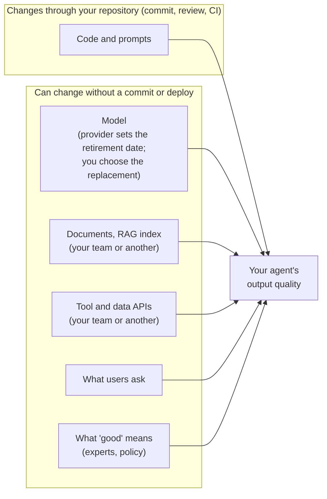
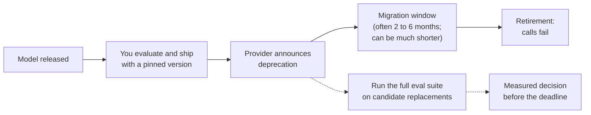

# Appendix B. Drift and model retirement { #background }

!!! abstract "About this appendix"
    **Optional background:** the detail and evidence behind "evals never finish" ([Module 1](01-why-evals.md#never-finish)) and the [migration playbook](appendix-a-model-migration.md). You do not need it to build your first evals; come back when you plan monitoring or a model change.

    **Reading time:** about 15 minutes.

## What can change without a commit { #linear-vs-living }

The diagram groups what decides your agent's output quality by whether a change to it goes through your repository. Who owns each box in the second group depends on your setup: some teams own their documents, tools and APIs end to end. Even they do not decide what users ask, when the business changes a policy, or when the provider retires a model (though they do choose the replacement).

Sculley et al. (Google, 2015) described this problem for ML systems as *"Changing Anything Changes Everything"*: even "improvements" to an input can have *"arbitrary detrimental effects"*, and tests *"are not sufficient"* in a changing world without live monitoring.

## Drift: when quality changes without a code change { #drift }

**Drift** is a sustained change, after you evaluated the system, in the conditions it runs under. An agent makes several model calls and reads several data sources, so every kind of drift applies, and a small early change can send it down a different path. Unlike classic ML, you usually cannot retrain a hosted model: you respond by changing prompts, documents, tools or the model, then re-running the evals. Two clarifications:

- **One strange input is not drift.** Drift is a shift in the pattern, and it can be **sudden** (a policy change on Monday), **gradual** (users slowly adopt a new product), or **recurring** (end-of-year billing questions every December).
- **Some drift is invisible from the inputs.** You can detect a change in *what users ask* by looking at inputs alone. You cannot detect a change in *what the correct answer is* that way: you need a signal of correctness, such as expert review, labels or a validated judge (Gama et al., 2014). This is why domain experts stay involved after launch.

The kinds that matter, using the course's running example, the [refund agent](index.md#running-example):

| Kind | What changes | Support-agent example |
|---|---|---|
| **Data drift** (input drift) | The mix of inputs. The right answer for any given input stays the same. | A new product launches and a third of questions are now about it; customers start writing in Spanish; after a billing outage everyone asks about double charges. |
| **Concept drift** | The correct answer for the same input. | The refund window changes from 60 to 30 days. "Can I get a refund after 45 days?" used to be "yes" and is now "no". |
| **Criteria drift** | What your experts mean by "good" (see [Module 3](03-define-and-collect.md#step-1)). | After reading traces, the expert decides that any mention of a legal complaint must trigger an offer to escalate, and that cheerful tone with an angry customer is a failure. |
| **Upstream drift** | Data your agent reads at run time: RAG documents, tool and API responses, data pipelines, whether your team or another owns them. Contract tests catch a schema change, but not a changed *value*. | The policy team publishes the new 30-day document but leaves the old 60-day one in the index (the [trace example](03-define-and-collect.md#step-2) shows exactly this). The order API starts returning `null` for `purchased_days_ago`. |
| **Silent model change behind an alias** | What a model name points to (see [pinned snapshots and floating aliases](#pin-vs-alias)). | You call a dateless alias and the provider repoints it to a newer snapshot. OpenAI did this to the `gpt-4o` alias on 2 October 2024. |
| **Judge drift** | Your grader. It is a model too, so everything above applies to it (see [Module 9](09-run-and-monitor.md#step-7)). | The hosted model behind your judge is retired and replaced, or the expert's criteria move and the judge's prompt does not. |

A policy change can leave the old answer in the prompt, the few-shot examples, the model's training, and your reference answers and golden labels, and it triggers no test run unless you start one. Criteria drift is often invisible too, happening in the expert's head between labelling sessions. Concept drift and upstream drift often arrive together: in the example, the policy changed (concept drift) *and* the old document is still retrieved (upstream drift).

What catches each kind is covered in [Module 9](09-run-and-monitor.md): [what to run when something changes](09-run-and-monitor.md#lifetime-regression), and [what to watch when nothing seems to have changed](09-run-and-monitor.md#step-7).

!!! example "Evidence that the 'same' model changes"
    Chen, Zaharia and Zou (2023) measured the March and June 2023 versions of GPT-3.5 and GPT-4 behind the same product names. GPT-4's accuracy at telling prime from composite numbers fell from 84% to 51%, while GPT-3.5 *improved* on the same task, and both made more formatting mistakes in generated code in June (figures from the current version of the paper). The authors concluded that the behaviour of the "same" LLM service can change substantially in a short time, *"highlighting the need for continuous monitoring of LLMs"*. Narayanan and Kapoor add a useful distinction: the model may not have become *less capable*, but its *behaviour* changed, and *"code that is deployed to users might simply break if the model underneath changes its behavior."* That is exactly the risk for your agent.

## The model you depend on will be retired { #model-retirement }

In classic ML a team owns its trained model and can redeploy a validated version for as long as it likes (it still retrains and re-evaluates as the world changes). With a hosted LLM (OpenAI, Anthropic, Google, or through AWS Bedrock or Azure) you can pin a version, evaluate it and approve the agent with it, but the provider will **deprecate** that version and then **retire** it, after which calls to it fail. Your team chooses the replacement; the provider sets the date. Models fine-tuned on a provider's platform retire with their base model; self-hosting an open-weight model avoids forced retirement, but you then run it yourself.

A replacement model usually accepts the same requests, but its behaviour on your task (refusals, tone, verbosity, cost, latency) can change, and providers' migration guides describe only general tendencies. The only way to know is to run your eval suite on both ([migration playbook](appendix-a-model-migration.md)).

### How long do models last? { #model-lifespans }

In short: recent production models have typically lasted **about 12 to 18 months from the provider's release date** (older ones often longer), and you may get only **weeks to a few months' notice** before a model is switched off.

??? info "Provider policies and observed lifespans, as of 24 October 2026 (check before relying on them)"
    These policies change: check the provider's deprecation page before relying on them.

    | Platform | Stated policy | Observed examples |
    |---|---|---|
    | **OpenAI** | At least 6 months' notice for generally available (GA) models and at least 3 months for specialised variants (chat, Codex, deep-research), "unless safety or compliance concerns require a faster timeline"; preview models can go on much shorter notice (for example 2 weeks). | On 14 October 2026 OpenAI announced that the dated GA snapshots of gpt-4o, gpt-4o-mini, gpt-4.1 and gpt-4.1-mini shut down on 14 January 2027: 3 months, half the stated GA minimum. In 2023, the beta Codex models were shut down 3 days after the announcement. |
    | **Anthropic** | At least 60 days' notice before retiring a publicly released model. Each active model shows a "not sooner than" retirement date; for current models this is roughly 12 months after release (a reading of the table, not a written policy). | Notice actually given has been about 2 to 6 months (Claude Haiku 3.5: 2 months; Claude Opus 3: about 6 months). |
    | **AWS Bedrock** | For models launched before 7 September 2026: at least 12 months from launch to end of life, with the last 6 months or more in a "Legacy" state. For end-of-life dates after 1 February 2026, the later part of the Legacy period is "public extended access", at higher prices set by the provider. In Legacy, new customers cannot adopt the model and **existing customers may lose access after 15 days of inactivity**, so a judge you run only occasionally can be cut off early. Newer models carry a per-model "end of life no sooner than" date and a Legacy (notice) period of 6 months (most models) or 45 days. Dates can differ by AWS Region. Migration is not automatic. | Dates differ from the provider's own: Claude Sonnet 4 reached end of life on Bedrock on 14 October 2026, but was retired on the Anthropic API on 15 June 2026. In a few Regions, Claude 3 Haiku entered Legacy on 10 October 2026 with an end-of-life date of 13 November 2026: about one month. |
    | **Azure (Microsoft Foundry)** | Standard GA lifecycle of 18 months (12 months for Anthropic, DeepSeek, Fireworks and Mistral AI models), with the retirement date set at launch and at least 60 days' notice. Once a 12-month model is deprecated, new subscriptions can no longer deploy it, so a team that sets up a new subscription can lose access to its approved model before the retirement date. Retirement dates "aren't extendable". Standard deployments can be **auto-upgraded** to a replacement unless you opt out (`versionUpgradeOption`). | After retirement, calls return HTTP `410 Gone`. |
    | **Google (Gemini)** | Listed shutdown dates are the "earliest possible"; no fixed minimum notice is published. | Gemini 1.5 stable versions were retired exactly 12 months after release. |

    **Typical lifespans.** An approximate count of 39 generally available or pinned model versions from OpenAI, Anthropic and Google, from release to shutdown (including some scheduled shutdowns), using the vendors' deprecation pages. These figures are the author's own approximate count, not a vendor statistic:

    - **Median about 16.5 months; middle half between about 13 and 22 months.** The mean (about 19 months) is pulled up by a few long-lived older OpenAI versions (the longest, gpt-4-0613, lasted about 40 months).
    - **Shortest for a GA model: about 12 months** (Claude 3.7 Sonnet about 11.8; Gemini 1.5 stable versions 12.0; Claude Opus 4.1 12.0; Claude 3.5 Sonnet v2 about 12.2).
    - **Lifespans are getting shorter.** Anthropic's models released from late 2024 onwards have lasted about 12 to 16 months (most about 12 to 13); its 2023 to mid-2024 models mostly lasted 16 to 25 months.
    - **Preview and specialised models can be far shorter:** gpt-4.5-preview lasted about 4.5 months; some OpenAI Codex variants and a Gemini Live variant about 8 to 10 months.

    A caveat on these numbers: models still in service are not counted, so recent lifespans may look shorter than they will turn out to be.

**Practical takeaway.** Lifespans are counted from the provider's **release date**, not from the day you ship. If you adopt a model that is already 6 months old, expect to migrate in well under a year. Plan to migrate each production model roughly every 12 to 18 months after its release, typically with 2 to 6 months' notice for GA models. Published minimums are not guarantees: OpenAI's October 2026 notice gave half its stated GA minimum, Bedrock allows 45 days for some models (and about a month in some Regions), preview models can go in weeks, and safety or security retirements can be faster still. **Plan for the shortest notice you have actually seen, not the policy.**

Every model in your system has its own clock: the agent's model, any sub-agent models, the judge, guardrail models and the **embedding model** behind your RAG index. Embedding models are retired too (Google retired `text-embedding-004` in January 2026), and vectors from two different embedding models cannot be compared, so a new embedding model means re-embedding every document in the index and re-testing retrieval.

### Pinned snapshots and floating aliases { #pin-vs-alias }

| | Floating alias | Pinned snapshot |
|---|---|---|
| Example | A dateless name or a `-latest` name that the provider can repoint, such as `gpt-4o` | A fixed, dated version ID such as `gpt-4o-2024-08-06`, or a Bedrock **inference profile** ID (a routing ID that sends requests to the same model version in several AWS Regions; the model version is part of the ID, so it does not move to a newer model on its own) |
| Risk | Behaviour can change with **no change on your side**, on your next API call: OpenAI moved the `gpt-4o` alias to a newer snapshot on 2 October 2024, and Azure Standard deployments auto-upgrade by default. | Much more stable, but not frozen: the provider can still change the serving infrastructure (hardware, numerical precision, bugs) without changing the ID, and it will retire the ID. |

**Pin versions** in production and for your judge, and record the exact version ID in every trace ([Module 3](03-define-and-collect.md#step-2)). Check what your provider's names mean: Anthropic, for example, states that from its 4.6 generation every model ID, including the dateless ones, is a pinned snapshot, while for older models the alias pointed to a dated ID.

**A pinned ID is not frozen.** Anthropic's September 2025 postmortem described three infrastructure bugs (request routing, a hardware misconfiguration and a compiler bug) that degraded some Claude models' outputs for several weeks with no change to any model ID. And pinning only **delays** the forced upgrade until retirement. Pin anyway: it removes one source of drift, and scheduled regression runs catch the rest.

### "Latest" is not automatically better { #latest-not-better }

A newer model is often better on the provider's benchmarks. Whether it is better **on your task, at your cost and latency budget** is a separate question, and there is public evidence that it can go either way:

- **A newer model can improve on one metric and regress on another.** OpenAI's system card for o3 and o4-mini (April 2025; a *system card* is the safety and evaluation report published with a model) reports results on PersonQA, a set of questions about facts on public figures. o3 answered more questions correctly than the older o1 (about 59% against 47%), but it also hallucinated in 33% of answers against 16% for o1, because it made more claims overall. The smaller o4-mini hallucinated in 48%. Whether that trade is acceptable depends on your task: a single overall score would have hidden the regression, and pass rates per failure mode would not.
- **Behaviour can regress in ways generic evals miss.** In April 2025 OpenAI rolled back an update to the GPT-4o model behind ChatGPT (and its floating API alias) after about four days, because it had become sycophantic (overly flattering and agreeable). In its follow-up post (OpenAI, *Expanding on what we missed with sycophancy*, May 2025), OpenAI said its offline evals and A/B tests had looked positive and that it *"didn't have specific deployment evaluations tracking sycophancy"*. The provider's evals are not your evals. (Teams that had pinned a dated API snapshot were not affected, which is the argument for [pinning](#pin-vs-alias).)
- **Cost and latency can move either way** (for example, reasoning models bill hidden reasoning tokens as output tokens, while some newer models are cheaper). Measure quality, cost and latency on every migration; do not assume.

The vendors say the same. Anthropic: *"consider thorough testing of your applications with the new models well before the retirement date."* Microsoft: *"evaluate candidate models against your own application, prompts, and representative data. Compare quality, latency, and cost together rather than relying on public benchmarks alone."*

## Key takeaways

- **Drift** comes in several kinds: data, concept, criteria, upstream, a silent model change and judge drift. Some are invisible from inputs alone.
- **Hosted models are retired**, recently every 12 to 18 months from release, sometimes with only weeks of notice. Plan for the shortest notice you have seen.
- **Pin model versions** and record them in every trace, but remember a pinned ID is not frozen.
- **Newer is not automatically better.** Measure quality, cost and latency on your own task.

**Next:** [Appendix C. Evals during development](appendix-c-evals-in-development.md)
